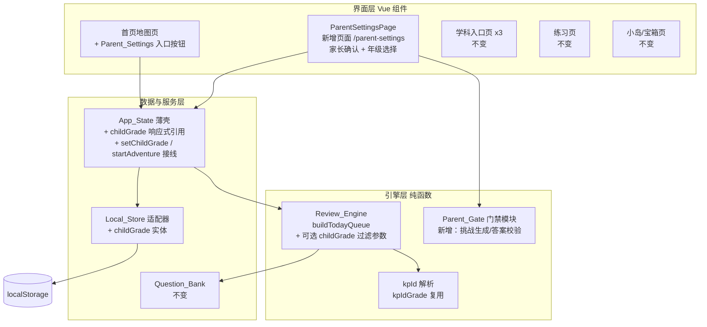
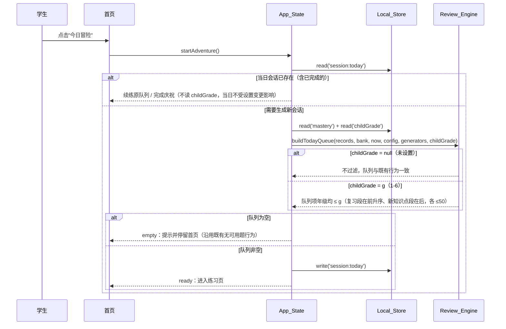
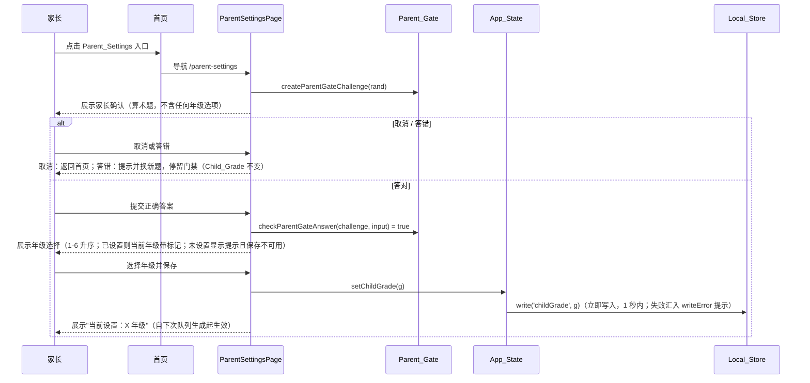

# Design Document

## Overview

本设计是"趣味学习冒险"（kids-learning-adventure）的第三期扩充设计，基于第一期已落地的 Vue 3 + Vite 纯前端架构（设计见 `.kiro/specs/kids-learning-adventure/design.md`）与第二期 multi-grade-mistake-book（设计见 `.kiro/specs/multi-grade-mistake-book/design.md`），实现家长一次设置、全局生效的"孩子年级"（Child_Grade）能力：

1. **家长设置入口与孩子年级设置（Parent_Settings）**：首页新增家长入口（触控区域 ≥44×44px，不与"今日冒险"大按钮竞争练习入口），点击后先经家长确认（算术题门禁），通过后进入孩子年级设置界面：一至六年级 6 个升序选项、当前年级可见标记、未设置状态提示、未选择时保存不可用；保存后 Child_Grade 持久化至 Local_Store。
2. **今日冒险按 Child_Grade 过滤出题**：`buildTodayQueue` 新增可选 `childGrade` 参数，在复习段与新知识点段的候选枚举点统一施加"年级 ≤ Child_Grade"谓词，覆盖 Requirement 2.1 的三个年级来源——题目的数值年级属性（`grade`）、口算生成器的年级参数、知识点按 knowledgePointId 年级段解析的年级（`kpIdGrade`）。未设置（null）时完全不过滤，与既有行为逐字节一致。
3. **Child_Grade 持久化与兼容**：Local_Store 新增 `childGrade` 实体（`number | null`），沿用既有键命名空间（`kla:v1:{accountId}:childGrade`）、损坏备份自愈、账号隔离与"变化后 1 秒内写入"契约；家长保存动作采用立即写入，消除"设置后当日首次生成读到旧值"的窗口。

现状勘察结论（设计依据，均来自对现有代码的核对）：

- `src/engine/reviewEngine.ts` 的 `buildTodayQueue(records, bank, now, config, generators)` 是纯函数，复习段从 `records` 枚举到点知识点、新知识点段从 `bank.queueEligible` 与 `generators` 枚举无记录知识点，候选项统一经 `pickItemForKnowledgePoint` 产出——过滤谓词只需加在少数几个枚举点上。
- `src/engine/kpId.ts` 已提供 `kpIdGrade`（解析 `cn.g5.zi.001` → 5，无法解析返回 null），且 multi-grade-mistake-book 的种子契约测试已强制"kpId 年级段 = 题目 grade 字段 = 生成器 grade 字段"，三处年级来源在正常数据下互相一致。
- `src/data/localStore.ts` 的实体机制（`EntityTypeMap` + 初始态工厂 + `isValidEntityValue` 校验分发 + 损坏备份 `backupCorrupted` + 调度写入 `schedule`）对新增实体是"登记式"扩充，`session:today` 已有"null 为合法值"的先例。
- `src/stores/appState.ts` 的 `startAdventure` 仅在"当日会话需要新生成"的分支调用 `buildTodayQueue`，且 `shouldGenerateTodayQueue` 保证当日已生成的会话不被重建——这正是"设置变更下次生成才生效、当日不受干扰"语义的天然落点。
- `src/engine/gradeSelector.ts` 的 `SUBJECT_GRADES.english = [3,4,5,6]` 与英语种子文件（仅 g3-g6）确认：英语无一、二年级内容，Child_Grade 为 1/2 时通用年级过滤天然排除英语队列项，无需学科特判。

关键设计决策与理由：

- **过滤内置于 `buildTodayQueue` 的可选参数，而非预过滤 QuestionIndex / 生成器 / Mastery_Record**。备选方案是参照学科页 `filterBankForGrade` 的做法，在调用方先把题库索引（`q.grade ≤ Child_Grade`）、生成器（`g.grade ≤ Child_Grade`）与记录集（`kpIdGrade ≤ Child_Grade`）各过滤一遍再交给既有 `buildTodayQueue`。不选它的理由：(1) 需要重建整个 QuestionIndex（O(题库) 的 Map 重建）并浅拷贝记录集，而内置过滤只在候选枚举时做一次谓词判断；(2) 三个预过滤器分散在三处，"复习段按 kpId 年级段排除"这条核心规则会落在引擎之外，属性测试难以锁定单一入口；(3) 内置可选参数默认 `null`，未设置时与既有代码路径完全一致（Requirement 3.1 的"未设置不过滤"由结构保证，而非靠测试碰运气）；(4) `buildTodayQueue` 保持纯函数，全部既有调用方与测试（一期 Property 7/8/9/24）不受影响。
- **复习段年级来源用 `kpIdGrade` 解析，解析失败（null）时排除该候选（fail-closed）**。Mastery_Record 自身不存年级字段，kpId 年级段是唯一来源；无法解析意味着"无法验证年级 ≤ Child_Grade"，对面向儿童的保护性过滤取保守方向（不出该题）。种子契约保证正常数据的 kpId 必有合法年级段，该分支只影响异常外来数据；新知识点段的题目与生成器因有直接的数值年级字段，直接用 `q.grade` / `g.grade` 判定，与 Requirement 2.1 的三个来源一一对应。
- **英语在一、二年级的排除不做学科特判**（Requirement 2.5）：英语种子自三年级起点，英语题目与 kpId 的年级均 ≥ 3，通用年级过滤在 Child_Grade ∈ {1,2} 时自然排除全部英语队列项；该推论由示例测试在真实种子题库上锁定。
- **家长确认采用随机两位数加法题（如 "23 + 18 = ?"），而非长按 3 秒**。理由：(1) 挑战生成是纯函数（随机源注入），可属性测试；长按计时依赖各设备触控事件可靠性，交互测试脆弱；(2) 加法题是儿童应用家长门禁的通行做法，本应用目标用户为低年级儿童，两位数加法超出其一、二年级心算范围而对家长零成本；(3) 明确定位：该门禁是防误触/防幼儿捣乱的屏障，不是安全边界，高年级孩子有意绕过是可接受的。
- **`setChildGrade` 立即写入（`store.write`）而非调度写入（`store.schedule`）**。Requirement 3.2 要求家长设置后当日首次生成队列即按新年级过滤：若沿用 800ms 调度落盘，家长保存后孩子立即点"今日冒险"会经 `store.read` 读到旧值。立即写入消除该读旧窗口，写失败同步抛出、当场汇入 `writeError` 提示（Requirement 4.7），且该操作极低频（家长偶发设置），同步写 localStorage 开销可忽略——与 `persistSession` 对重要进度采用立即写入是同一取舍。"1 秒内写入"与"多次变化取最后值"（Requirement 4.2）由立即写入平凡成立。
- **"当日不重建、下次生成生效"不引入新机制**：`shouldGenerateTodayQueue` 的当日门控保证已生成的 Today_Session 不被重建（Requirement 3.3/3.4），`startAdventure` 仅在生成分支读取 `store.read('childGrade')`，使新年级天然自下一次生成（下一自然日首次进入）起生效（Requirement 2.9/3.5）；过滤对 records 只读，`setChildGrade` 只写 `childGrade` 一个键，Mastery_Record、Wrong_Set、Star_Wallet 等全部既有数据在设置与过滤全过程中不被触碰（Requirement 2.4/3.6）。

## Architecture

### 分层结构（变更部分加粗）



### 数据流一：今日冒险生成（Child_Grade 过滤）



### 数据流二：家长设置孩子年级



### 模块职责（新增与变更）

| 模块 | 职责 | 关键约束 |
|---|---|---|
| Parent_Gate 门禁模块（新，纯函数 `src/engine/parentGate.ts`） | 生成家长确认算术挑战、校验作答 | 纯函数，随机源注入；操作数为 [12,49] 整数，answer=a+b |
| Review_Engine（变更 `src/engine/reviewEngine.ts`） | `buildTodayQueue` 新增可选 `childGrade` 参数，候选枚举点统一施加年级谓词 | 纯函数、不修改入参；`childGrade=null` 时与既有行为逐字节一致；复习段仍按 nextReviewAt 升序在前、新知识点段在后，各段上限不变 |
| kpId 解析（复用 `src/engine/kpId.ts`） | 复习段知识点年级来源 | `kpIdGrade` 无法解析返回 null，过滤谓词对 null 取 fail-closed（排除） |
| Local_Store 适配器（变更 `src/data/localStore.ts`） | 新增 `childGrade` 实体的类型、初始态、校验器登记 | 键命名空间、损坏备份自愈、账号隔离契约不变；初始态 null |
| App_State 薄壳（变更 `src/stores/appState.ts`） | 启动恢复 childGrade 响应式引用；`setChildGrade` 立即持久化；`startAdventure` 生成分支传入 childGrade | 仅在生成分支读取 childGrade；当日已生成会话不读、不重建 |
| ParentSettingsPage（新页面 `src/pages/ParentSettingsPage.vue`） | 家长确认步骤 → 年级选择界面；未设置提示；保存与当前设置展示 | 门禁通过前不渲染任何年级选项；年级选项触控 ≥44×44px；未选择时保存不可用 |
| 首页地图页（变更 `src/pages/HomePage.vue`） | 顶栏新增 Parent_Settings 入口按钮（未设置时带可见标记） | 入口触控 ≥44×44px；点击仅导航，不启动任何练习；"今日冒险"保持首页唯一练习入口 |
| 学科入口页 / 练习页 / 小岛宝箱页 | 不变 | 学科页先选年级再练习流程不受 Child_Grade 影响（Requirement 2.8） |

## Components and Interfaces

### 引擎与数据接口（TypeScript 类型签名）

```ts
// ============ Review_Engine：今日队列按 Child_Grade 过滤 ============
// （src/engine/reviewEngine.ts）

import { kpIdGrade } from './kpId';

/**
 * 年级上限谓词（childGrade 过滤的统一判定）：
 * - childGrade 为 null/undefined（未设置）：不过滤，恒为 true；
 * - childGrade 已设置：grade 必须可判定（非 null）且 ≤ childGrade；
 *   grade 为 null（kpId 年级段无法解析）时 fail-closed 排除。
 */
function gradeWithinLimit(
  grade: number | null,
  childGrade: number | null | undefined
): boolean;

/**
 * 生成今日队列（新增可选 childGrade 参数，默认 null = 未设置不过滤）。
 *
 * 过滤施加于候选枚举点（Requirement 2.1 的三个年级来源）：
 * - 复习段：到点记录追加条件 gradeWithinLimit(kpIdGrade(rec.knowledgePointId), childGrade)，
 *   年级超限或不可解析的到点知识点不进入复习段（Requirement 2.3），其记录本身不被修改
 *   （Requirement 2.4）；
 * - 新知识点段（题库）：枚举 bank.queueEligible 时要求 gradeWithinLimit(q.grade, childGrade)；
 * - 新知识点段（生成器）：枚举 generators 时要求 gradeWithinLimit(g.grade, childGrade)；
 * - pickItemForKnowledgePoint 内部取题/取生成器时同样施加谓词，防止契约破坏数据
 *   （q.grade 与 kpId 年级段不一致）经复习段混入。
 *
 * 其余语义不变：复习段按 nextReviewAt 升序在前、新知识点段在后，
 * 各段数量上限不变（Requirement 2.7）；childGrade=null 时输出与
 * 既有五参调用完全一致（Requirement 3.1）。
 */
export function buildTodayQueue(
  records: Record<string, MasteryRecord>,
  bank: QuestionIndex,
  now: number,
  config: SessionConfig,
  generators: readonly GeneratorParams[] = [],
  childGrade: number | null = null
): QueueItem[];

// ============ Parent_Gate 门禁模块（新，纯函数） ============
// （src/engine/parentGate.ts）

/** 家长确认挑战：两位数加法题 */
export interface ParentGateChallenge {
  a: number;
  b: number;
  answer: number; // 恒等于 a + b
}

/** 操作数取值范围（两位数加法，超出一、二年级心算范围，对家长零成本） */
export const GATE_OPERAND_MIN = 12;
export const GATE_OPERAND_MAX = 49;

/**
 * 生成家长确认挑战：a、b 为 [GATE_OPERAND_MIN, GATE_OPERAND_MAX] 内整数，
 * answer = a + b。随机源注入（默认 Math.random），便于测试定盘。
 */
export function createParentGateChallenge(
  rand?: () => number
): ParentGateChallenge;

/**
 * 校验家长确认作答：输入去除首尾空白后须为十进制整数字符串，
 * 且数值等于 challenge.answer；空串、非数字、错误数值均返回 false。
 */
export function checkParentGateAnswer(
  challenge: ParentGateChallenge,
  input: string
): boolean;

// ============ Local_Store：childGrade 实体登记 ============
// （src/data/localStore.ts）

/** 各实体的值类型映射（新增一行） */
export interface EntityTypeMap {
  // ……既有实体不变……
  /**
   * Child_Grade（孩子年级）：1-6 整数；null 表示未设置（初始态）。
   */
  childGrade: number | null;
}

// 初始态工厂新增：childGrade: () => null

/**
 * Child_Grade 校验（Requirement 4.5）：
 * null（未设置）或 1-6 整数；其余（非整数、越界、对象、字符串等）视为损坏，
 * 走既有备份自愈路径（备份后按未设置启动）。
 */
export function isChildGrade(value: unknown): value is number | null;

// isValidEntityValue 分发新增：case 'childGrade': return isChildGrade(value);

// ============ App_State：接线 ============
// （src/stores/appState.ts）

export interface AppState {
  // ……既有成员不变……
  /** 孩子年级（响应式；null = 未设置）。启动时从 Local_Store 恢复（Requirement 4.3） */
  readonly childGrade: Ref<number | null>;
  /**
   * 设置孩子年级（1-6 整数；非法值防御性忽略）：
   * 同步更新响应式引用并立即写入 Local_Store（Requirement 1.6、4.1、4.2）；
   * 写失败汇入 writeError，内存态保持已选年级可见（Requirement 4.7）。
   */
  setChildGrade(grade: number): void;
}

// createAppState 内部：
// const childGrade = ref<number | null>(store.read('childGrade'));
//
// startAdventure 生成分支（仅此处读取 childGrade，Requirement 2.9/3.3/3.5）：
// const queue = buildTodayQueue(
//   store.read('mastery'), bank, now, SESSION_CONFIG, generators,
//   store.read('childGrade')
// );
```

### 页面设计（新增与变更）

| 页面 | 路由 | 内容与交互 |
|---|---|---|
| 首页地图页（变更） | `/` | 顶栏右侧（音效开关旁）新增 Parent_Settings 入口按钮（👨‍👩‍👧 图标 + "家长"文字，触控区域 ≥44×44px，Requirement 1.1）；Child_Grade 未设置时按钮带可见未设置标记（红点/角标，Requirement 1.8）；点击仅 `router.push('/parent-settings')`，不启动任何练习；"今日冒险"大按钮保持首页唯一练习入口，其余区块（学科入口、宝箱小岛、庆祝层、提示条）不变 |
| ParentSettingsPage（新增） | `/parent-settings`（路由名 `parent-settings`） | 内部两步状态机 `step: 'gate' \| 'picker'`，初始为 gate：**gate 步骤**展示家长确认卡（"请家长回答：a + b = ?"、数字输入框、确认/取消按钮），不渲染任何年级选项（Requirement 1.2）；答错显示错误提示并自动更换新题，取消返回首页，两种情形 Child_Grade 均不变（Requirement 1.3）；`checkParentGateAnswer` 通过才进入 picker。**picker 步骤**展示 6 个年级按钮（一年级→六年级固定升序，每个触控 ≥44×44px，Requirement 1.4）；Child_Grade 未设置时全部不选中、显示"还未设置孩子年级"提示且保存按钮禁用（Requirement 1.5、1.8），已设置时当前年级按钮带差异化标记（颜色 + ✓ 图标，Requirement 1.9）；选择后保存可用，保存调用 `setChildGrade` 并展示"当前设置：X 年级"与"自明天起的今日冒险生效"说明（Requirement 1.6、3.5）；已设置后再次进入可重新选择并覆盖保存（Requirement 1.7） |

### 家长确认交互细节（选定方案与理由）

- **挑战形态**："请家长回答：{a} + {b} = ?"，a、b ∈ [12,49] 整数（和 ≤ 98）。该范围超出一、二年级课内心算水平（20 以内加减），对家长零成本；挑战由 `createParentGateChallenge(rand)` 纯函数生成，组件挂载时与每次答错后各生成一次。
- **通过与失败**：确认按钮提交后经 `checkParentGateAnswer` 判定；通过进入 picker 步骤；失败显示"回答不正确，请再试一次"并换新题（防止暴力枚举同一题）；取消按钮直接 `router.push('/')`，全程不读写 `childGrade`（Requirement 1.3）。
- **定位说明**：门禁用于防止低龄孩子误触修改设置，不构成对有意绕过的高年级孩子的安全边界——这是儿童应用家长门禁的通行定位，Requirement 1.2/1.3 仅约束"先确认后展示选项"与"未通过不改变设置"。

### 与学科页年级过滤的关系（不变部分）

学科入口页的精确年级流程（`filterBankForGrade(index, subject, grade)` 等值过滤 + `session:subjects` 组合会话）与 Child_Grade 完全正交：学科页练习内容仅由所选年级决定，不读取、不参考 childGrade（Requirement 2.8）。本期不改名、不改签名、不改行为；`filterBankForGrade` 保持"学科+年级等值"语义，与 `buildTodayQueue` 新增的"年级 ≤ Child_Grade"语义各自独立。

## Data Models

### localStorage 数据模型（新增实体）

键命名空间不变：`kla:v1:{accountId}:{entity}`，备份键 `kla:v1:{accountId}:backup:{entity}:{timestamp}`。实体表（其余实体见一期与二期设计，不变）：

| 实体 | 键后缀 | 结构 | 变更 |
|---|---|---|---|
| Child_Grade | `childGrade` | `number \| null`：1-6 整数；null 表示未设置；初始态 `null` | 新增 |

读写契约（沿用既有机制，扩展至新实体）：

- **写入**：家长保存时 `setChildGrade` 调用 `store.write('childGrade', grade)` 立即落盘——满足"变化后 1 秒内写入"与"1 秒内多次变化取最后值"（Requirement 4.2，立即写入使二者平凡成立），且每次写入完成后从 Local_Store 读出值与写入值相等（Requirement 4.1）。
- **读取恢复**：启动时 `createAppState` 以 `store.read('childGrade')` 初始化响应式引用，本地同步读取，页面打开后 2 秒内完成恢复且与最后一次成功写入一致（Requirement 4.3，与既有实体同一机制与口径）。
- **校验与自愈**：`isChildGrade` 接受 null 或 1-6 整数。键不存在 → 按未设置（null）启动且不创建备份（Requirement 4.4）；JSON 无法解析或值非法（如 `"abc"`、`7`、`2.5`、`{}`）→ 原值复制到备份键（同一会话内不覆盖）、按未设置启动、其他实体不受影响，此后家长新设置仍正常写入持久化（Requirement 4.5）。
- **账号隔离**：`childGrade` 键按 `kla:v1:{accountId}:` 前缀隔离，默认账号 `default`；一个账号下的读写不触及另一账号的对应数据（Requirement 4.6）。
- **写失败**：`store.write` 抛出 `LocalStoreWriteError`，`setChildGrade` 捕获后汇入 `writeError`，界面提示"本次进度可能无法保存"，不阻断练习，响应式引用保持已设置值在界面上可见（Requirement 4.7）。
- **升级保留**：既有数据无 `childGrade` 键，升级后首次读取按未设置启动（Requirement 4.4）；既有全部实体（mastery/wrongSet/wallet/collection/session:today/session:subjects/oralBest/settings/lastGrade）的校验器与读写路径不变，升级过程不被清除或重置，且 Child_Grade 设置前今日冒险保持未设置不过滤行为（Requirement 4.8、3.1）。

### 其余数据模型（不变）

- Question / GeneratorParams / MasteryRecord / TodaySession / Wrong_Set 等结构均无变更；Child_Grade 是单一整数全局设置，不按学科区分。
- 过滤只发生在队列生成的候选枚举阶段，Mastery_Record 的全部字段（level/totalCorrect/totalWrong/nextReviewAt/mastered/lastAnswerAt）在读与写路径上均不因过滤或设置变更而被新增、删除或修改（Requirement 2.4、3.6）；Child_Grade 调高后，原被排除的到点知识点因记录完好而在下次生成时自然重新成为复习段候选（Requirement 2.10）。

## Correctness Properties

*A property is a characteristic or behavior that should hold true across all valid executions of a system-essentially, a formal statement about what the system should do. Properties serve as the bridge between human-readable specifications and machine-verifiable correctness guarantees.*

以下属性针对本期新增与变更的纯函数（`buildTodayQueue` 的 childGrade 过滤、Parent_Gate 门禁）、Local_Store 的 `childGrade` 实体与 App_State 接线。时间与随机源通过参数注入，存储通过内存 mock 注入。UI 布局、触控尺寸、标记视觉差异、导航跳转等不以属性覆盖，改由示例/组件测试保障（见 Testing Strategy）。

属性测试生成器约定：kpId 按 `{cn|math|en}.g{N}.{后缀}` 形态生成（N ∈ 1-6），并按种子契约使题目 `grade`、生成器 `grade` 与 kpId 年级段 N 一致；同时混入少量畸形 kpId（缺年级段、N 越界、无前缀）覆盖 fail-closed 分支。

### Property 1: 按孩子年级过滤的队列纯净

*For any* Mastery_Record 集合、题库索引、口算生成器集合、时间 now、会话配置与任意 childGrade ∈ 1-6，`buildTodayQueue(records, bank, now, config, generators, childGrade)` 的输出队列应满足：每个 kind='bank' 队列项对应题目的 `grade` ≤ childGrade；每个 kind='generated' 队列项对应生成器参数的 `grade` ≤ childGrade；每个队列项的 `kpIdGrade(knowledgePointId)` 可解析且 ≤ childGrade；且任何年级超限（或年级段不可解析）的到点复习知识点不出现在复习段，任何年级超限的可入队题/生成器知识点不出现在新知识点段。

**Validates: Requirements 2.1, 2.2, 2.3**

### Property 2: 过滤后队列组织规则保持

*For any* 与 Property 1 相同的输入域且 childGrade ∈ 1-6，过滤后的输出队列应满足：复习段（source='review'）按对应记录的 nextReviewAt 非递减升序排列；任意复习段项都排在任意新知识点段项（source='new'）之前；复习段项数 ≤ maxReviewPerSession，新知识点段项数 ≤ maxNewPerSession。

**Validates: Requirements 2.7**

### Property 3: 过滤不修改掌握度记录

*For any* Mastery_Record 集合、题库索引、生成器集合、now、配置与任意 childGrade（含 null 与 1-6），调用 `buildTodayQueue` 后入参 records 与调用前深相等（不新增、不删除、不修改任何记录的任何字段），题库索引与生成器集合同样不被修改。

**Validates: Requirements 2.4**

### Property 4: 未设置与既有行为等价

*For any* Mastery_Record 集合、题库索引、生成器集合、now 与配置：`buildTodayQueue(..., generators, null)` 的输出与既有五参调用 `buildTodayQueue(..., generators)` 的输出深相等；且 `buildTodayQueue(..., generators, 6)` 的输出与未过滤输出深相等（全部内容年级 ≤ 6）。

**Validates: Requirements 3.1**

### Property 5: 过滤单调性与调高再纳入

*For any* 与 Property 1 相同的输入域与任意两个年级 gLow ≤ gHigh：以 childGrade=gLow 生成的队列知识点集合是以 childGrade=gHigh 生成的子集，后者又是未过滤（childGrade=null）队列的子集；特别地，*for any* 年级高于 gLow 而不高于 gHigh 的到点未掌握知识点，它在 gLow 队列中缺席而在 gHigh 队列中（有可用题/生成器时）出现于复习段。

**Validates: Requirements 2.10**

### Property 6: 设置变更的生效时机（App_State 接线）

*For any* 年级 g1、g2（1-6）、任意当日会话形态（无会话 / 当日进行中 / 当日已完成 / 昨日会话）与任意时钟：以内存存储与注入时钟创建 App_State 并持久化上述会话后调用 `setChildGrade(g2)`——(a) 当日会话已存在（进行中或已完成）时，当日再次 `startAdventure` 不改变已存储会话：进行中则续练且队列深等于变更前、下一道未完成题不变，已完成则返回 done 且不重新生成；(b) 当日会话不存在（无会话或仅昨日会话）时，其后 `startAdventure` 生成的队列中每个队列项年级均 ≤ g2；(c) 时钟推进到下一自然日后 `startAdventure` 生成的队列中每个队列项年级均 ≤ g2。

**Validates: Requirements 2.9, 3.2, 3.3, 3.4, 3.5**

### Property 7: 设置孩子年级不触碰其他实体

*For any* 存储内容（mastery/wrongSet/wallet/collection/session:today/session:subjects/oralBest/settings/lastGrade 任意合法值组合）与任意年级 g ∈ 1-6：调用 `setChildGrade(g)` 后，存储中除 `childGrade` 键外的全部键值与调用前逐一深相等（不新增、不删除、不修改任何其他实体的任何记录）。

**Validates: Requirements 3.6**

### Property 8: 孩子年级持久化读写往返

*For any* 合法 Child_Grade 值（null 或 1-6 整数）：写入 Local_Store 后再读出，得到与写入值相等的值；以同一底层存储创建新的适配器实例（模拟关闭浏览器后重开）后读出，仍与最后一次成功写入的值一致。

**Validates: Requirements 4.1, 4.3**

### Property 9: 1 秒内写入且最后写入生效

*For any* 孩子年级变化序列（长度 ≥ 1 的 1-6 整数序列，模拟 1 秒内连续多次设置）：依次调用 `setChildGrade` 后，Local_Store 中读出的 `childGrade` 恒等于序列最后一个值；且单次变化在调用返回后即可从 Local_Store 读出（立即写入，满足 1 秒时限）。

**Validates: Requirements 4.2, 1.7**

### Property 10: 缺失数据按未设置启动且无备份

*For any* 不含 `childGrade` 键的存储（其余键任意）：读取 `childGrade` 返回 null（未设置），且读取后存储中不产生任何 `backup:childGrade` 备份键。

**Validates: Requirements 4.4**

### Property 11: 损坏数据自愈、备份保留且此后可正常写入

*For any* 无法解析为合法 Child_Grade 的存储值（非法 JSON 串，或 JSON 合法但值非 null/1-6 整数，如 `7`、`2.5`、`"3"`、`{}`、`[]`、`true`）：读取时按未设置返回 null；原始损坏值被复制到独立备份键且同一会话内再次读取不覆盖该备份；存储中其他实体的键值不受影响；此后写入新的合法 Child_Grade 仍正常持久化并可读回。

**Validates: Requirements 4.5**

### Property 12: 孩子年级账号隔离

*For any* 两个不同账号标识 A≠B 与任意合法 Child_Grade 值：在账号 A 下写入后读 A 得到等价值；此时读账号 B 得到 null（未设置）；A 的写入不改变 B 下已存的任何值。

**Validates: Requirements 4.6**

### Property 13: 家长确认挑战生成与校验

*For any* 随机源输出序列，`createParentGateChallenge(rand)` 生成的挑战满足：a、b 均为 [12, 49] 内整数且 answer = a + b；*for any* 挑战，`checkParentGateAnswer(challenge, String(challenge.answer))` 恒为 true，且 *for any* 不等于 answer 的整数输入、空串、非数字字符串，校验恒为 false。

**Validates: Requirements 1.2, 1.3**

## Error Handling

| 故障场景 | 检测点 | 处理策略 |
|---|---|---|
| Local_Store 无 `childGrade` 键（新装/老版本数据） | 实体读取 | 按未设置（null）启动，不创建备份；今日冒险保持未设置不过滤行为（Req 4.4、4.8、3.1） |
| `childGrade` JSON 无法解析或值非法（越界/非整数/错误类型） | 实体读取校验 `isChildGrade` | 原值复制备份键（会话内不覆盖）、按未设置启动、其他实体不受影响；此后家长新设置正常写入持久化（Req 4.5） |
| 写入 Local_Store 失败（存储不可用/空间不足） | `setChildGrade` 写入 catch | 汇入 `writeError`，界面提示"本次进度可能无法保存"，不阻断练习；响应式引用保持已设置年级在界面可见（Req 4.7） |
| 家长确认答错 | `checkParentGateAnswer` 返回 false | 显示错误提示并自动更换新挑战题，停留在门禁步骤，不展示年级选项，Child_Grade 不变（Req 1.2、1.3） |
| 家长确认取消 | 取消按钮 | 返回首页，全程不读写 `childGrade`，已存值不变（Req 1.3） |
| 过滤后今日冒险无可用题（复习段与新知识点段均空） | `startAdventure` 生成分支 | 沿用既有无可用题行为：提示并使学生停留首页，不进入练习界面（Req 2.6） |
| Mastery_Record 的 kpId 年级段无法解析（异常外来数据） | 复习段候选谓词 `gradeWithinLimit(kpIdGrade(kpId))` | fail-closed：Child_Grade 已设置时该知识点不入队；未设置时不受影响（正常种子数据由契约测试保证必有合法年级段） |
| `setChildGrade` 收到非法年级（非 1-6 整数，防御性分支） | `setChildGrade` 入口 | 直接忽略，不更新引用、不写存储（UI 仅提供合法选项，正常流程不可达） |
| 题库整体加载失败 | 启动聚合加载（既有） | 沿用既有 fatal 路径：常显提示、停止进入练习流程；Parent_Settings 设置功能不受影响 |

## Testing Strategy

### 测试框架与库

- 单测与属性测试：**Vitest**（既有 `npm test` = `vitest --run`）
- 属性测试库：**fast-check**（devDependencies 已具备，不自行实现）
- 组件测试：**@vue/test-utils** + jsdom
- 每个属性测试运行**最少 100 次迭代**，并以注释标注对应设计属性，标签格式：`**Feature: child-grade-setting, Property {n}: {property_text}**`
- 属性测试文件沿用既有目录约定放入 `tests/property/`（如 `childGrade.props.spec.ts`、`parentGate.props.spec.ts`），单元/组件测试放入 `tests/unit/`，关键链路集成测试放入 `tests/integration/`

### 单元测试（示例与边界）

- 首页入口（Req 1.1、1.8）：Parent_Settings 入口按钮存在且触控区域 ≥44×44px；"今日冒险"仍是唯一练习入口，点击入口仅导航 `/parent-settings`、不调用 `startAdventure`；Child_Grade 未设置时入口显示未设置标记，已设置后不显示
- 家长确认步骤（Req 1.2、1.3）：挂载后仅展示门禁、DOM 中无任何年级选项；答对进入年级选择；答错显示错误提示、更换新题、停留门禁且 Child_Grade 不变；取消返回首页且存储不变
- 年级选择界面（Req 1.4、1.5、1.8、1.9）：6 个年级按钮按一年级至六年级升序、每个触控 ≥44×44px；未设置时全部未选中、保存按钮禁用且显示未设置提示；已设置时当前年级按钮带差异化标记（参数化抽查若干年级），重新选择并保存覆盖原值（Req 1.7 的 UI 半）
- 保存与展示（Req 1.6）：选择年级保存后存储值与界面"当前设置"展示一致，并展示"自明天起生效"说明
- 英语排除示例（Req 2.5）：以真实种子题库与生成器调用 `buildTodayQueue`，childGrade=1 与 2 时输出队列不含任何 subject='english' 的队列项；种子契约断言全部英语题目与生成器 grade ≥ 3（与 multi-grade 契约同口径）
- 过滤后无可用题（Req 2.6）：构造过滤后两段均空的场景（如仅高年级内容 + childGrade=1），`startAdventure` 返回 empty，首页提示并停留
- 学科页不受扰（Req 2.8）：存入 childGrade 后，学科页年级流程（`filterBankForGrade` + 五参 `buildTodayQueue` + `session:subjects`）输出与存入前完全一致
- 启动恢复（Req 4.3）：预置已写 childGrade 的内存存储创建 App_State，`childGrade` 引用立即恢复为已存值
- 写失败（Req 4.7）：注入 `setItem` 抛错的存储，`setChildGrade` 后 `writeError` 有提示、`childGrade` 引用保持新值、`startAdventure` 仍可用
- 升级保留（Req 4.8）：预置一期/二期各实体数据（无 childGrade 键），启动后逐键断言既有数据不变、`childGrade` 为 null、今日冒险按未设置不过滤生成

### 属性测试

13 条设计属性（Property 1-13）各由一个 fast-check 属性测试实现，生成器覆盖：

- 任意 Mastery_Record 集合（混合已掌握/到点/未到点/未来时间）、任意题库索引（phase=1/2 与二期题型混合，kpId 按契约形态生成并混入少量畸形 kpId）、任意生成器集合、任意 now 与任意会话配置、任意 childGrade（null 与 1-6）
- 任意两个年级 gLow ≤ gHigh（单调性）；任意当日会话形态与任意时钟（接线属性，内存存储 + 注入时钟 + 真实种子题库）
- 任意合法 Child_Grade 值与任意变化序列（往返与最后写入）；任意损坏字符串与损坏 JSON 值（自愈）；任意双账号组合（隔离）；任意随机源序列（门禁挑战）
- 边界由生成器覆盖：childGrade=1/6 边界、kpId 年级段不可解析、空记录集、空题库、全超年级内容（过滤后空队列）、nextReviewAt 恰等于 now、单元素变化序列

### 集成与冒烟测试

- 家长设置主链路（jsdom + 内存 localStorage）：首页点击 Parent_Settings 入口 → 完成家长确认 → 选择三年级保存 → 首页入口未设置标记消失 → 次日（注入时钟推进）今日冒险队列各项年级 ≤ 3 → 关闭重开（新 App_State 实例）后设置仍生效
- 当日不受扰链路：当日生成并作答部分题目 → 家长修改年级 → 当日续练队列与下一题不变 → 次日新队列按新年级过滤
- 升级冒烟：预置一期/二期格式全部实体 → 启动 → 既有数据不变、错题集/星星/掌握度可见、今日冒险未设置不过滤

### 不适用 PBT 的部分及原因

入口与选项的触控尺寸（≥44×44px）、标记/角标的视觉差异、未设置提示文案、门禁步骤的 DOM 结构切换、导航跳转、"2 秒内恢复"的时延阈值，均不具备"对全部输入成立"的可计算不变量，按上文以组件示例测试与集成冒烟覆盖，不编写属性测试。
