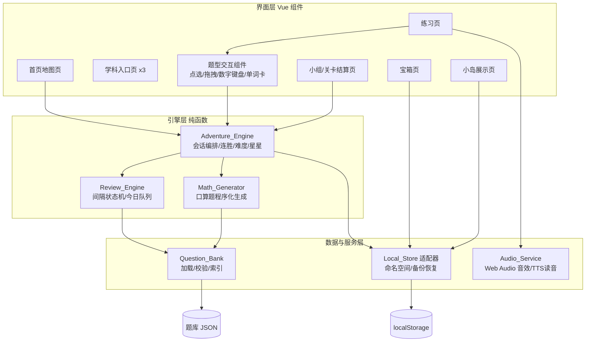
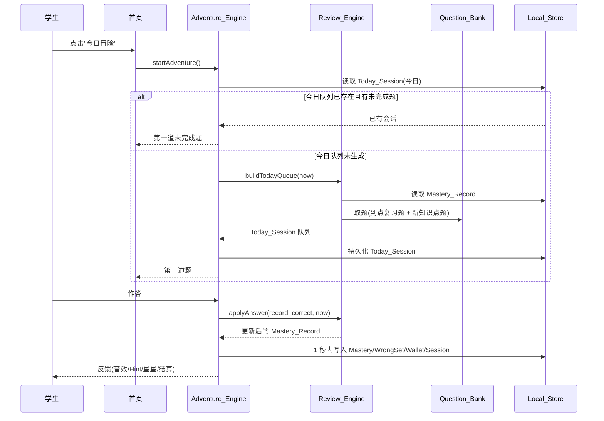

# Design Document

## Overview

"趣味学习冒险"（kids-learning-adventure）是一个纯前端的网页版 H5 游戏化记忆系统，技术栈为 Vue 3 + Vite，无后端服务。系统将艾宾浩斯间隔重复包装为"今日冒险"闯关玩法：学生点击首页唯一的大按钮即可开始约 10 分钟的练习，答对得星星、星星开宝箱、宝箱出收集品。全部学习数据（掌握度、错题、星星、收集品、今日练习、设置）按账号标识隔离存储在浏览器 localStorage 中。

本设计覆盖第一期（MVP）：语文大陆（人教版三四年级七类基础题型）、数学王国（三四年级全部单元知识点六类题型，其中口算速算为程序化生成）、英语岛（外研版三起三四年级单词记忆卡）。题库为结构化 JSON，启动时校验，坏题跳过；题型字段为二三期（阅读理解、跟读评分、多步骤应用题）预留。

关键设计决策与理由：

- **纯函数引擎层**：复习引擎与冒险引擎的核心逻辑（间隔状态机、今日队列生成、星星结算、难度调节）实现为不依赖 DOM 与 I/O 的纯函数模块，便于属性测试（PBT）与后续移植。
- **生成器与题库分离**：口算速算题由"知识点参数 → 随机题目"的生成器产出，不进题库 JSON；其余题目全部来自题库 JSON。这样题库体积可控，口算题数值永不重复。
- **存储层带备份的自愈设计**：读取时校验，损坏数据改名备份后按初始状态启动，保证孩子永远不会因为数据损坏而打不开应用。
- **一期单账号、结构预留多账号**：所有 localStorage 键带账号命名空间，一期固定默认账号，三期仅切换账号标识即可支持多孩子。

## Architecture

### 分层结构



### 数据流（今日冒险主流程）



### 模块职责

| 模块 | 职责 | 关键约束 |
|---|---|---|
| Review_Engine | 维护每个知识点的间隔级别状态机；生成今日队列 | 纯函数，时间通过参数注入 |
| Adventure_Engine | 会话编排、3 题分组、10 分钟关卡计时、连胜/连错计数、难度调节、星星结算、错题当日重出 | 纯函数核心 + 薄壳副作用 |
| Math_Generator | 按知识点参数随机生成口算题（题干、数值、答案、难度） | 同参数多次生成数值随机；答案必须可判定 |
| Question_Bank | 加载题库 JSON、逐题校验、跳过坏题并记日志、按学科/年级/单元/知识点索引 | 二期题型载入但不进今日队列 |
| Local_Store 适配器 | 命名空间读写、序列化/反序列化、损坏备份与初始态恢复、写入失败上报 | 键格式 `kla:v1:{account}:{entity}` |
| Audio_Service | Web Audio 合成音效（对/错/星星/宝箱）、生字/单词读音播放、音效开关 | 音频失败不阻塞作答 |

## Components and Interfaces

### 引擎接口（TypeScript 类型签名）

```ts
// ============ 复习引擎 ============
type IntervalLevel = 1 | 2 | 3 | 4 | 5;
const INTERVALS_MS: Record<IntervalLevel, number> = {
  1: 10 * 60 * 1000,        // 10 分钟
  2: 1 * 24 * 3600 * 1000,  // 1 天
  3: 3 * 24 * 3600 * 1000,  // 3 天
  4: 7 * 24 * 3600 * 1000,  // 7 天
  5: 15 * 24 * 3600 * 1000, // 15 天
};

interface MasteryRecord {
  knowledgePointId: string;
  level: IntervalLevel;
  totalCorrect: number;
  totalWrong: number;
  nextReviewAt: number | null; // 已掌握为 null
  mastered: boolean;
  lastAnswerAt: number;
}

// 作答结果应用：返回新记录；答错时 requeue=true 表示需当日重出
function applyAnswer(
  rec: MasteryRecord | null,
  correct: boolean,
  now: number
): { record: MasteryRecord; requeue: boolean };

// 今日队列生成：到点复习题(按 nextReviewAt 升序) 在前，新知识点题在后
function buildTodayQueue(
  records: Record<string, MasteryRecord>,
  bank: QuestionIndex,
  now: number,
  config: SessionConfig
): QueueItem[];

// ============ 冒险引擎 ============
interface SessionConfig {
  groupSize: 3;
  levelTargetMs: 10 * 60 * 1000;
  maxNewPerSession: number;
  maxReviewPerSession: number;
}

interface TodaySession {
  date: string;              // 本地自然日 'YYYY-MM-DD'
  queue: QueueItem[];        // 题目或生成器参数项
  currentIndex: number;      // 下一道未作答位置
  streak: number;
  consecutiveWrong: number;
  difficultyOffset: 0 | -1;  // 连错 3 题后为 -1
  levelStartedAt: number;
  elapsedMs: number;
  status: 'active' | 'done';
  results: AnswerResult[];
}

interface QueueItem {
  kind: 'bank' | 'generated';
  questionId?: string;            // kind=bank
  generatorParamsId?: string;     // kind=generated（口算）
  knowledgePointId: string;
  subject: 'chinese' | 'math' | 'english';
  type: QuestionType;
  difficulty: 1 | 2 | 3 | 4 | 5;
  source: 'review' | 'new' | 'retry';
}

function groupIntoGroups<T>(queue: T[], size: 3): T[][]; // 末组 1~3
function nextUnanswered(session: TodaySession): QueueItem | null;
function applyFirstAnswer(session, correct, now): { session, stars, events }; // 连胜/翻倍/连错降难度
function applyRetry(session, correct, now): { session, events };               // 重试答对按答错记
function shouldLowerDifficulty(consecutiveWrong: number): boolean;

// ============ 星星与宝箱 ============
function awardAnswer(streakAfter: number): 5 | 10; // 3 的倍数翻倍
function openTreasureBox(
  wallet: StarWallet,
  collection: IslandCollection,
  roll: () => number           // 注入随机源便于测试
): { wallet: StarWallet; collection: IslandCollection; outcome: 'new' | 'duplicate' | 'insufficient' };

// ============ 题库 ============
function validateQuestion(raw: unknown): { ok: true; q: Question } | { ok: false; error: string };
function loadQuestionBank(json: string): { questions: Question[]; errors: BankError[] } | { fatal: string };
function generateOralQuestion(params: GeneratorParams, rand: () => number): GeneratedQuestion;
```

### 页面设计

| 页面 | 路由 | 内容与交互 |
|---|---|---|
| 首页地图页 | `/` | 卡通地图背景；"今日冒险"大按钮（唯一练习入口，完成后变为"已完成"态并展示庆祝画面）；三科入口（语文大陆/数学王国/英语岛，入口页内同样由"今日冒险"机制驱动对应学科会话）；星星余额（变化 1 秒内刷新）；宝箱与小岛入口；音效开关 |
| 学科入口页 | `/subject/:id` | 学科主题卡通形象与入口，不让学生在开始前做科目外选择；展示该学科今日进度 |
| 练习页 | `/practice` | 题区（按题型渲染交互组件）、Streak 实时计数、进度指示（第 X 组第 Y 题）、口算关 10 分钟倒计时、Hint 条、重听/重播按钮 |
| 小组结算页 | 练习页弹层 | 本组结果、"继续"/"休息"两个大按钮（≥44×44px） |
| 关卡结算页 | 练习页弹层 | 关卡结果、+10 星星、口算关展示"本关答对 vs 历史最佳"及新纪录提示 |
| 宝箱页 | `/box` | 宝箱动画、"开启（30 星星）"按钮旁标注消耗、余额不足提示与"去闯关"引导、产出物展示（新物品入收藏/重复返 5 星） |
| 小岛展示页 | `/island` | 已收集宠物与装扮展示、"已收集 N/12"计数 |

### 题型交互组件

| 组件 | 适用题型 | 交互 |
|---|---|---|
| ChoicePad（点选） | 拼音选择、多音字、判断、选择、单词卡图片/拼写 4 选 1 | 大号圆角选项卡（≥44×44px），点选后高亮并提交判定 |
| DragMatch（拖拽） | 词语搭配、成语填空、形近字辨析、单位换算 | Pointer Events 统一触摸/鼠标拖拽，拖到目标槽位吸附；拖拽目标槽 ≥44×44px |
| NumericKeypad（数字键盘） | 口算速算、填空、几何计算 | 屏幕大数字键盘（0-9、小数点、删除、确认），不调用系统键盘，不需打字 |
| WordCard（单词卡） | 英语单词记忆卡 | 卡片展示图片+拼写，自动播放发音一次，重播按钮不限次；音频失败时显示提示但图片拼写可用 |
| DictationCard（听写卡） | 生字听写 | 展示时自动播放读音一次，重听按钮不限次，作答用点选/拖拽拼合，不键盘输入 |

所有作答判定在 1 秒内完成（本地比对标准答案，无网络请求）。

## Data Models

### 题库 JSON Schema

题库为单个 JSON 文件（构建期打包进应用），顶层结构：

```json
{
  "version": 1,
  "questions": [ /* Question[] */ ],
  "generators": [ /* GeneratorParams[]，仅数学口算 */ ]
}
```

**Question（每道题）**：

```json
{
  "id": "cn-g3-u1-dict-0001",
  "subject": "chinese",                  // chinese | math | english（语文/数学/英语）
  "grade": 3,                            // 整数 1-6
  "volume": "A",                         // A=上册 B=下册
  "unit": "u1",                          // 单元/Module 标识
  "type": "dictation",                   // 见下表
  "knowledgePointId": "cn.g3.zi.001",
  "difficulty": 2,                       // 整数 1-5
  "stem": "听读音，选出正确的生字",
  "media": { "audio": "audio/cn/g3/xxx.mp3", "image": "img/en/g3/cat.png" },
  "options": [ { "id": "a", "text": "…", "image": "…" } ],
  "answer": { "choice": ["a"] },         // 按题型：choice/order/pairs/number/bool
  "hint": "注意偏旁是木字旁",
  "analysis": "不超过100字的解析",
  "phase": 1                             // 1=一期可用；2=二期题型（载入但跳过）
}
```

**题型枚举**（`type` 字段）：

| 学科 | 一期题型 | 二期预留（phase=2，载入不入队） |
|---|---|---|
| chinese | dictation（生字听写）、pinyin（拼音选择）、similar_char（形近字辨析）、polyphone（多音字辨析）、word_match（词语搭配）、idiom_fill（成语填空）、poem_chain（古诗文接龙） | reading（阅读理解） |
| math | oral（口算速算，由生成器产出）、blank（填空）、judge（判断）、choice（选择）、unit_conv（单位换算）、geometry（几何计算） | word_problem（多步骤应用题） |
| english | word_card（单词记忆卡） | read_aloud（跟读评分） |

**GeneratorParams（数学口算生成器参数，按知识点配置）**：

```json
{
  "id": "gen-math-g3-add-3digit",
  "knowledgePointId": "math.g3.add.within10000",
  "grade": 3,
  "difficulty": 2,
  "template": "{a} + {b} = ?",
  "operands": {
    "a": { "min": 100, "max": 9999, "integer": true },
    "b": { "min": 100, "max": 9999, "integer": true }
  },
  "operation": "add",                    // add | sub | mul | div | mixed
  "constraints": {
    "resultMin": 0,                      // 减法不许负数
    "resultMax": 19998,
    "divisible": false,                  // 除法是否要求整除
    "decimalPlaces": 0                   // 结果小数位上限
  },
  "answerFormat": "number"
}
```

生成规则：随机源注入；在 operands 范围内取随机数，套用 operation 计算答案，校验 constraints，不满足则重采（有限次后放宽）。生成的题目与题库题走同一判定与复习管线，`knowledgePointId` 用于掌握度记录。

### localStorage 数据模型

键命名空间：`kla:v1:{accountId}:{entity}`，一期 `accountId` 固定为 `default`。备份键：`kla:v1:{accountId}:backup:{entity}:{timestamp}`（损坏时保留，本次会话不覆盖）。

| 实体 | 键后缀 | 结构 |
|---|---|---|
| Mastery_Record | `mastery` | `Record<kpId, MasteryRecord>`（见引擎接口） |
| Wrong_Set | `wrongSet` | `{ items: [{ questionRef, knowledgePointId, wrongAt, retriedCorrect }] }`；questionRef 为题库题 id 或生成器签名（`gen:{paramsId}:{operandsHash}`） |
| Star_Wallet | `wallet` | `{ balance: number, totalEarned: number }` |
| Island_Collection | `collection` | `{ items: string[] }`，12 件可收集物（6 宠物 + 6 装扮）的全集为常量 |
| Today_Session | `session:today` | 见 `TodaySession` 接口（含 date、queue、currentIndex、streak、consecutiveWrong、difficultyOffset、elapsedMs、status、results） |
| 口算最佳纪录 | `oralBest` | `Record<generatorParamsId, { best: number, achievedAt: number }>` |
| 设置 | `settings` | `{ soundOn: boolean }`（默认 true） |

读取契约：每个实体读取时做 JSON 解析 + 必需字段校验；失败则把原始值复制到备份键、该实体按初始态启动（mastery/wrongSet/collection 为空、wallet.balance=0、settings.soundOn=true）。写入契约：数据变化后 1 秒内写入；写失败时提示"本次进度可能无法保存"，内存态继续可用。

## Correctness Properties

*A property is a characteristic or behavior that should hold true across all valid executions of a system-essentially, a formal statement about what the system should do. Properties serve as the bridge between human-readable specifications and machine-verifiable correctness guarantees.*

以下属性均针对引擎层与数据层的纯函数实现，时间与随机源通过参数注入，存储通过内存 mock 注入。UI 布局、音频播放、视觉风格等不可计算的需求不以属性覆盖，改由示例测试与人工检查保障（见 Testing Strategy）。

### Property 1: 下一未答题定位

*For any* 合法 Today_Session（任意队列长度、任意已作答前缀），`nextUnanswered(session)` 应返回队列中第一个未作答的题目；当且仅当全部题目已完成（status='done'）时返回 null。

**Validates: Requirements 1.3, 1.5, 2.7**

### Property 2: 三题分组不变量

*For any* 题目队列（任意长度 n≥0），`groupIntoGroups(queue, 3)` 的结果应满足：除最后一组外每组恰为 3 题，最后一组为 1 至 3 题，且全部组拼接后与原始队列逐元素相等（不丢题、不重题、不改序）。

**Validates: Requirements 2.1, 7.9**

### Property 3: 会话持久化往返

*For any* 合法 Today_Session，将其序列化写入 Local_Store 后再读出恢复，得到的会话与原始会话在 queue、currentIndex、results、streak 上等价，且恢复后的 `nextUnanswered` 结果与写入前一致。

**Validates: Requirements 2.4, 2.5, 2.8**

### Property 4: 首次答对建立一级间隔

*For any* 尚无 Mastery_Record 的知识点和任意时间 now，`applyAnswer(null, true, now)` 应产出 level=1、totalCorrect=1、nextReviewAt = now + 10 分钟、mastered=false 的记录。

**Validates: Requirements 3.2**

### Property 5: 答对升级间隔序列

*For any* 未标记已掌握、当前级别为 1 至 4 级且 totalCorrect>0 的 Mastery_Record 和任意时间 now，答对后级别应递增一级，且 nextReviewAt = now + 新级别对应间隔（1 天/3 天/7 天/15 天）。

**Validates: Requirements 3.3**

### Property 6: 答错重置并当日重出

*For any* 未标记已掌握的 Mastery_Record（任意级别）和任意时间 now，`applyAnswer(rec, false, now)` 应产出 level=1、nextReviewAt = now + 10 分钟、mastered=false 的记录，且 requeue=true（该知识点被追加到当日练习队列）。

**Validates: Requirements 3.4**

### Property 7: 五级答对即掌握且永不再入队

*For any* 当前级别为 5 级（15 天）的 Mastery_Record 和任意时间 now，答对后该记录 mastered=true 且 nextReviewAt=null；并且对任意包含已掌握记录的输入，`buildTodayQueue` 的输出队列不包含该知识点的题目。

**Validates: Requirements 3.7**

### Property 8: 今日队列排序与分段

*For any* Mastery_Record 集合与题库，`buildTodayQueue` 的输出应满足：所有到点复习题（nextReviewAt ≤ now 且未掌握）按 nextReviewAt 从最早到最晚升序排列，且任意复习题都排在任意新知识点题之前；当到点复习集合为空时，队列全部由新知识点题组成。

**Validates: Requirements 3.5, 3.6, 1.4, 1.6**

### Property 9: 今日队列按自然日只生成一次

*For any* 本地日期 d 与已有会话状态：当已存在 date=d 的 Today_Session 时，进入练习沿用该会话而不重新生成；仅当不存在 date=d 的会话时才生成新队列。

**Validates: Requirements 3.8, 3.9**

### Property 10: 重试答对按答错记

*For any* Mastery_Record 与任意时间 now，重试后答对对掌握度的更新应与 `applyAnswer(rec, false, now)` 的结果完全一致（视为答错一次）。

**Validates: Requirements 4.3**

### Property 11: 首次作答计数转移

*For any* 会话状态（任意 streak、任意 consecutiveWrong）：首次作答答对后 streak 加 1 且 consecutiveWrong 归 0；首次作答答错后 streak 归 0 且 consecutiveWrong 加 1；且首错后 retryLeft=1、当前题保持不变。

**Validates: Requirements 4.1, 4.4, 4.5, 4.8**

### Property 12: 星星发放规则

*For any* 首次作答答对后的 streak 值 s（s≥1），该题发放星星数应为：s 是 3 的倍数时 10 颗，否则 5 颗，且 Star_Wallet 余额恰好增加该数量。

**Validates: Requirements 4.6, 5.1**

### Property 13: 连错降难度且不低于下限

*For any* 会话与学科（该学科题库最低难度为 minD）：当连续首次答错计数达到 3 时，后续出题难度下调 1 级且结果不低于 minD；首次答对后该计数归零，不再触发下调。

**Validates: Requirements 4.7, 4.8**

### Property 14: 宝箱开启守恒

*For any* Star_Wallet 余额 b≥30、任意 Island_Collection 与任意随机源结果：开启宝箱后余额恰为 b-30；若产出物品不在收藏中则该物品被加入收藏且余额不再变化；若产出物品已在收藏中则收藏不变且余额为 b-30+5；收藏中任意物品始终至多出现一次。

**Validates: Requirements 5.3, 5.4, 5.6, 5.7**

### Property 15: 星星不足不可开箱

*For any* 余额 b<30 的 Star_Wallet 与任意 Island_Collection，开启宝箱应返回 outcome='insufficient'，且余额与收藏均保持不变。

**Validates: Requirements 5.5**

### Property 16: 判定与标准答案一致

*For any* 合法题目（任意题型、任意 answer 形态）与任意学生作答，判定结果正确当且仅当作答与题库标准答案按该题型的比对规则相等；判定在本地完成、不依赖网络。

**Validates: Requirements 6.5, 8.5**

### Property 17: 口算生成器产出合法且答案正确

*For any* 合法 GeneratorParams 与任意随机源，生成的口算题应满足：操作数落在 operands 范围内、结果满足 constraints（如减法非负、除法整除、小数位上限）、且随附答案等于按 operation 对生成操作数的真实计算结果。

**Validates: Requirements 7.3**

### Property 18: 历史最佳纪录更新

*For any* 本关答对数 score 与历史最佳 prevBest（可能不存在）：结算后新纪录应为 prevBest 不存在时的 score，否则为 max(score, prevBest)；当且仅当 prevBest 不存在或 score > prevBest 时产生"新纪录"提示。

**Validates: Requirements 7.6, 7.7, 7.8**

### Property 19: 单词卡选项构造

*For any* 单词卡练习题，选项应恰为 4 个，其中与所学单词匹配的正确选项恰为 1 个，其余 3 个干扰项互不相同且均不等于正确项。

**Validates: Requirements 8.4**

### Property 20: 题库校验过滤

*For any* 题目集合（合法与非法题任意混合），启动加载后：所有必需字段齐全且取值合法的题目被全部载入并可按学科/年级/单元索引检索到；所有非法题目被跳过且各自产生一条标识该题的错误日志；载入数 + 错误数 = 总数。

**Validates: Requirements 9.3, 9.4, 9.6**

### Property 21: 题库整体损坏即失败

*For any* 无法解析为合法题库结构的 JSON 字符串，`loadQuestionBank` 应返回 fatal 错误、记录错误日志，且不产出任何可用题目（系统据此停止进入练习流程）。

**Validates: Requirements 9.5**

### Property 22: 存储读写往返与多账号隔离

*For any* 实体值（Mastery_Record、Wrong_Set、Star_Wallet、Island_Collection、设置）与任意账号标识 A≠B：写入 A 后读 A 得到等价值；在写 A 之后读 B 得到该实体的初始状态，两账号互不影响。

**Validates: Requirements 10.1, 10.2, 10.3, 12.7, 13.5**

### Property 23: 损坏数据自愈与备份保留

*For any* 无法解析或缺少必需字段的存储值：读取时该实体按初始状态返回（Mastery_Record 空、Wrong_Set 空、余额 0、收藏空），原始损坏值被复制到独立备份键，且同一会话内再次读取/写入不覆盖该备份。

**Validates: Requirements 10.4**

### Property 24: 二期题型不入今日队列

*For any* 包含二期题型（语文阅读理解、英语跟读评分、数学多步骤应用题）题目的题库与任意 Mastery_Record 集合，`buildTodayQueue` 的输出不包含任何 phase=2 的题目。

**Validates: Requirements 13.7**

## Error Handling

| 故障场景 | 检测点 | 处理策略 |
|---|---|---|
| 题库 JSON 整体无法解析 | 启动加载 | 记录错误日志、首页提示"题库加载失败"、停止进入练习流程（Req 9.5） |
| 单题缺字段/取值越界/二期题型 | 启动逐题校验 | 跳过该题、记录含题标识的错误日志、其余正常加载（Req 9.4、13.7） |
| localStorage 数据损坏或缺字段 | 实体读取 | 原值复制到 `backup:{entity}:{ts}` 备份键（会话内不覆盖）、该实体按初始态启动（Req 10.4） |
| localStorage 写入失败（不可用/满） | 写入 catch | 提示"本次进度可能无法保存"，内存态保留，界面进度可见可继续（Req 10.6） |
| 单词/生字音频加载或播放失败 | Audio_Service catch | 显示"音频播放失败"提示，图片与拼写正常展示，作答与判定不受影响（Req 8.7） |
| 音效播放失败（Web Audio 不可用） | Audio_Service catch | 静默降级：关闭本次音效，不阻塞任何交互 |
| 口算生成器采样冲突（约束无法满足） | 有限次重采后 | 放宽上限约束重新采样；仍失败则换下一知识点题并记日志 |
| 今日队列为空（无可用题） | 队列生成 | 首页提示并保持停留，不进入练习界面（Req 1.7） |
| 离线 | — | 纯前端无网络依赖；页面已加载后答题、判定、保存、星星、错题全流程可用（Req 10.5） |
| 时钟回拨（nextReviewAt 在未来） | 队列生成 | 仅纳入 nextReviewAt ≤ now 的知识点；异常时间的记录留待自然到期，不做特殊修正 |

所有错误日志统一写入内存日志缓冲并尝试持久化到 `kla:v1:{account}:logs`（失败时仅保留内存态），包含时间戳、实体、题目标识与原因。

## Testing Strategy

### 测试框架与库

- 单测与属性测试：**Vitest**（与 Vite 集成）
- 属性测试库：**fast-check**（JavaScript/TypeScript 主流 PBT 库，不自行实现）
- 组件测试：**@vue/test-utils** + jsdom
- 每个属性测试运行**最少 100 次迭代**，并以注释标注对应设计属性，标签格式：`**Feature: kids-learning-adventure, Property {n}: {property_text}**`

### 单元测试（示例与边界）

聚焦具体例子、集成点与错误条件，避免与属性测试重复：

- 首错展示 Hint 且不含答案；重试仍错展示答案 + ≤100 字解析 + 鼓励文案 + 下一题入口（Req 4.1、4.2）
- 完成关卡 +10 星星；星星变化 1 秒内 UI 刷新（Req 5.2、5.9）
- 听写题展示时自动播放一次、重听不限次；单词卡重播（mock Audio_Service，Req 6.3、6.6、8.3、8.6）
- 音频失败降级：提示可见、图片拼写可用、可作答（mock reject，Req 8.7）
- 口算关 10 分钟倒计时结束自动结算、未答不计入答对数（注入时钟，Req 7.4、7.5）
- 音效开关：默认开；关闭即停当前音效且后续不播；答案对错音效不同且答错音效 ≤1 秒、答对动画 ≤3 秒（Req 12.3-12.6）
- 写存储失败提示且内存进度可见（mock 写抛错，Req 10.6）
- 小岛页显示 N/12（Req 5.8）；宝箱入口旁展示 30 星星消耗（Req 5.3）
- 种子数据契约：语文七类题型齐全、数学覆盖三四年级全部单元知识点与六类题型、英语单词卡含图片/音频/拼写、种子仅覆盖三四年级、题型枚举含二期三类（Req 6.1、6.2、7.1、7.2、8.1、8.2、13.4、13.8）
- 空题库/无可出题时停留首页并提示（Req 1.7）
- UI 静态断言：首页仅"今日冒险"一个练习入口；可点击元素触控区域 ≥44×44px；MVP 界面无二期功能入口（Req 1.1、12.2、13.6）

### 属性测试

24 条设计属性（Property 1-24）各由一个 fast-check 属性测试实现，生成器覆盖：

- 任意 Today_Session（随机队列/进度/计数）、任意 Mastery_Record（随机级别/次数/时间/掌握标记）、任意时间与日期
- 任意钱包余额与收藏子集、注入随机源控制宝箱产出新/旧物品
- 任意合法/非法题目混合集、任意损坏 JSON 串、任意 GeneratorParams 与随机源
- 任意存储实体值与双账号组合、任意损坏存储值
- 边界由生成器覆盖：空队列、1-2 题队列、level 边界 1/4/5、streak 恰为 3 的倍数、余额恰为 29/30、连错恰为 3、nextReviewAt 恰等于 now

### 集成与冒烟测试

- 关键流程端到端（jsdom + 内存 localStorage）：打开应用 → 今日冒险 → 答完全部题（含答错重试）→ 小组/关卡结算 → 星星到账 → 开宝箱 → 小岛查看 → 关闭重开恢复进度（Req 1-5、10 主链路）
- 断网冒烟：禁用网络后完成一次完整练习流程（Req 10.5）
- 多端与布局：人工/视觉回归在 320px、768px、桌面宽度及 iOS Safari、Android Chrome、桌面 Chrome/Edge/Safari 验证无横向滚动、布局自适应与横竖屏切换进度保持（Req 11）

### 不适用 PBT 的部分及原因

UI 渲染与视觉风格（卡通界面、动画时长观感）、多端兼容性、性能阈值（2 秒出题、1 秒判定/写入）与人工体验类需求不具备"对全部输入成立"的可计算不变量，按上文以示例测试、冒烟测试与人工检查覆盖，不编写属性测试。
