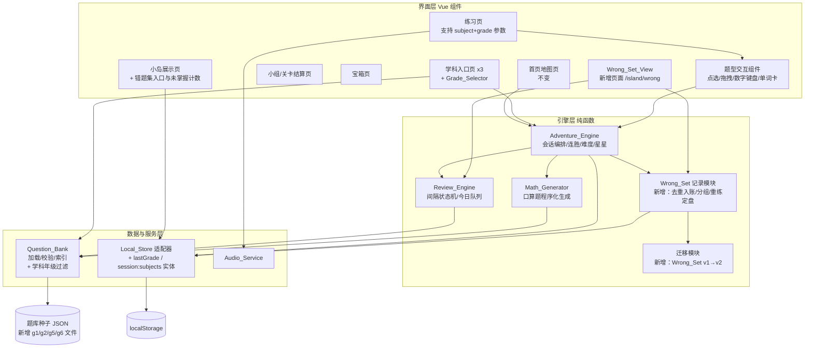
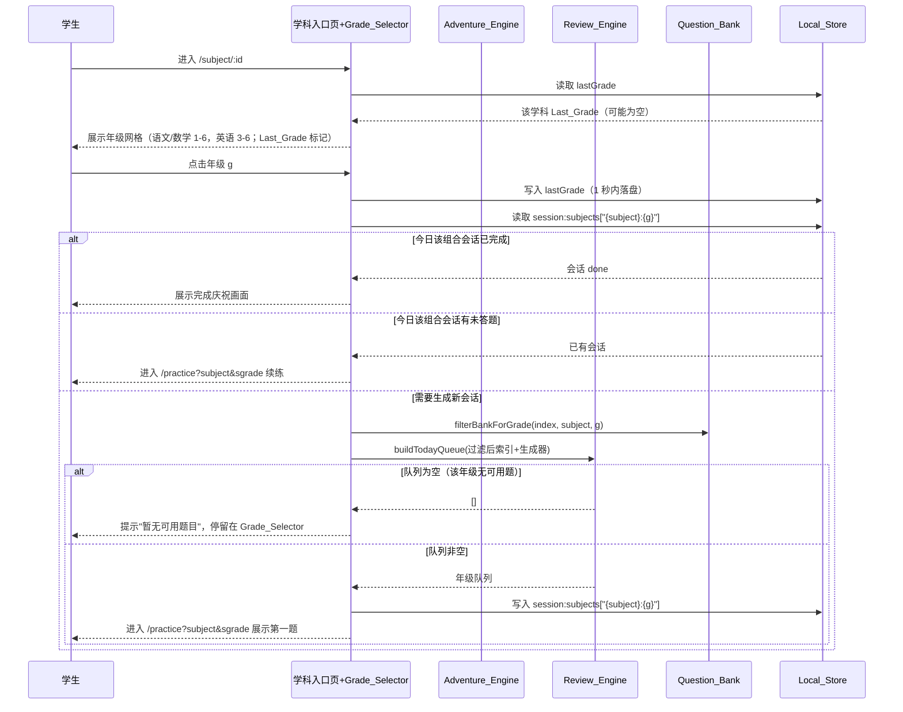

# Design Document

## Overview

本设计是"趣味学习冒险"（kids-learning-adventure）的第二期扩充设计，基于第一期已落地的 Vue 3 + Vite 纯前端架构（源码见 `src/`，设计见 `.kiro/specs/kids-learning-adventure/design.md`），实现三项能力：

1. **学科入口年级选择**：学科入口页（`/subject/:id`）由"直接开始冒险"改为先展示 Grade_Selector（年级选择页），学生点击年级即进入该学科该年级的练习。语文/数学提供一至六年级，英语提供三至六年级（外研版三年级起点）。首页"今日冒险"入口及其行为完全不变。
2. **题库扩充至一至六年级**：新增年级种子文件（语文/数学 g1、g2、g5、g6，英语 g5、g6，数学口算生成器 g1、g2、g5、g6），现有三、四年级种子文件内容不变。知识点标识强制包含年级段，从结构上保证不同年级掌握度隔离。
3. **错题集记录与查看**：重定义 Wrong_Set 记录规则（去重、答错次数、仅首个答案入账），Wrong_Set 数据结构升级为 v2（增加学科、年级、答错次数字段），并在"我的小岛"新增错题集入口与 Wrong_Set_View 页面，支持分组查看、答案解析与错题重练。

关键设计决策与理由：

- **年级隔离落在知识点标识上，而非新增过滤层**：现有知识点标识已采用 `cn.g3.zi.001`、`math.g3.add.within10000` 等含年级段的命名。本设计将该命名固化为契约（种子契约测试强制"标识年级段 = 题目年级字段"），Mastery_Record 无需任何结构变更即天然按年级隔离，题库索引按学科+年级过滤后交给既有 `buildTodayQueue` 管线即可保证队列纯净。
- **进度按"学科:年级"组合键存储**：新增 `session:subjects` 实体（`Record<"{subject}:{grade}", TodaySession>`），学科流程的会话按组合键独立读写；首页"今日冒险"继续使用既有 `session:today`，两条流程互不干扰，一期会话数据无需迁移。
- **Wrong_Set 同键原地升级 + 形状检测迁移**：v2 数据沿用既有 `wrongSet` 键，读取时按形状识别旧版数据（缺 `wrongCount` 字段）并自动迁移（从知识点标识推导学科/年级、按题目引用去重合并），不做版本号标记、不做备份重置，满足"旧数据保留可查看"的兼容要求。
- **已掌握错题标记为派生状态**：错题的"已掌握"不冗余存储，由 `mastery[knowledgePointId].mastered` 实时推导。知识点被 Review_Engine 标记掌握时错题自动呈现已掌握，永不出现标记与掌握度不一致。
- **口算生成题快照随错题入账**：生成题的 `questionRef` 是哈希签名、不可逆，为满足"以原题重练"，首次答错时把生成题快照（题干、操作数、答案）存入错题记录的可选字段；无快照的历史生成题错题降级为按生成器模板重新出题。

## Architecture

### 分层结构（变更部分加粗）



### 导航流程（学科练习主流程变更）



### 模块职责（新增与变更）

| 模块 | 职责 | 关键约束 |
|---|---|---|
| Grade_Selector（学科入口页内） | 展示学科可选年级、Last_Grade 标记、点击年级直接进入练习 | 语文/数学 6 个、英语 4 个选项升序；触控区域 ≥44×44px；空年级提示并停留 |
| Wrong_Set 记录模块（新，纯函数） | 首错入账去重、答错次数累计、重练定盘、分组排序、未掌握计数 | 纯函数，时间注入；同一题目引用至多一条记录 |
| 迁移模块（新，纯函数） | Wrong_Set v1→v2 形状检测与迁移、kpId 学科/年级推导 | 不触碰 wallet/collection/mastery 等其他实体 |
| Question_Bank | 既有加载/校验/索引之上，新增按学科+年级过滤索引与按年级过滤生成器 | 过滤后交给既有 buildTodayQueue，生成管线不变 |
| Local_Store 适配器 | 新增 `lastGrade` 与 `session:subjects` 实体校验；wrongSet 校验升级为 v2（含 v1 迁移入口） | 键命名空间、备份自愈、1 秒落盘契约不变 |
| Wrong_Set_View（新页面） | 分组错题列表、答案解析详情、未掌握错题重练、空状态引导 | 重练判定复用既有 judge；掌握度更新复用 applyAnswer |
| 练习页 | 支持 `?subject=&grade=` 参数，学科流程按组合键读写会话 | 无参数时行为与一期完全一致（今日冒险流程） |

## Components and Interfaces

### 引擎与数据接口（TypeScript 类型签名）

```ts
// ============ 年级选择（Grade_Selector） ============

/** 各学科可选年级：语文/数学一至六年级，英语三至六年级（外研版三年级起点） */
const SUBJECT_GRADES: Record<Subject, readonly number[]> = {
  chinese: [1, 2, 3, 4, 5, 6],
  math: [1, 2, 3, 4, 5, 6],
  english: [3, 4, 5, 6],
};

/** 学科可选年级列表（升序，与 SUBJECT_GRADES 一致） */
function gradeOptionsFor(subject: Subject): readonly number[];

/** Last_Grade 实体：仅记录学生选择过年级的学科 */
type LastGrade = Partial<Record<Subject, number>>;

/**
 * 计算某学科应标记的年级：Last_Grade 中该学科有记录且该记录
 * 属于本学科可选年级时返回该年级，否则返回 null（不显示任何标记）。
 */
function markedGrade(lastGrade: LastGrade, subject: Subject): number | null;

// ============ 题库按学科+年级过滤 ============

/** 学科年级组合键："{subject}:{grade}"，如 "math:3" */
type SubjectGradeKey = `${Subject}:${number}`;
function subjectGradeKey(subject: Subject, grade: number): SubjectGradeKey;

/** 按学科+年级过滤题库索引：结果中每道题的 subject 与 grade 均等于入参 */
function filterBankForGrade(
  index: QuestionIndex,
  subject: Subject,
  grade: number
): QuestionIndex;

/** 按年级过滤口算生成器参数（英语/语文传入空数组的等价结果） */
function filterGeneratorsForGrade(
  generators: readonly GeneratorParams[],
  grade: number
): GeneratorParams[];

/**
 * 分组合会话的纯函数更新：写入 key 对应会话，其余组合键的会话逐值保持不变。
 * 持久化：整体写入 session:subjects 实体（Record<SubjectGradeKey, TodaySession>）。
 */
function saveSubjectSession(
  all: Record<string, TodaySession>,
  key: SubjectGradeKey,
  session: TodaySession
): Record<string, TodaySession>;

// ============ Wrong_Set 记录模块（纯函数） ============

/** 口算生成题快照：仅 kind=generated 的错题入账时携带，用于按原题展示与重练 */
interface GeneratedSnapshot {
  paramsId: string;
  stem: string;
  operands: Record<string, number>;
  answer: number;
}

/** Wrong_Set v2 元素（同一 questionRef 至多一条记录） */
interface WrongSetItem {
  questionRef: string;          // 题库题 id 或生成器签名 gen:{paramsId}:{operandsHash}
  subject: Subject;
  grade: number;                // 整数 1-6
  knowledgePointId: string;
  wrongAt: number;              // 最近一次答错时间戳
  wrongCount: number;           // 累计答错次数（首错为 1）
  generated?: GeneratedSnapshot;
}

interface WrongSet {
  items: WrongSetItem[];
}

/** 首错入账入参（由练习壳层从当前题快照构造） */
interface FirstWrongEntry {
  questionRef: string;
  subject: Subject;
  grade: number;
  knowledgePointId: string;
  generated?: GeneratedSnapshot;
}

/**
 * 首次作答答错入账（Req 4.1-4.3）：
 * - questionRef 不存在：追加新记录，wrongAt=now、wrongCount=1；
 * - questionRef 已存在：更新该记录 wrongAt=now、wrongCount+1，其余字段不变，
 *   不新增记录（集合长度不变，同引用仍至多一条）。
 */
function recordFirstWrong(set: WrongSet, entry: FirstWrongEntry, now: number): WrongSet;

/**
 * 重试（非首个答案）对 Wrong_Set 的影响（Req 4.4、4.5）：
 * 无论重试答对或答错，恒返回原集合（不修改任何记录的 wrongAt 与 wrongCount，
 * 答对也不移除该题）。
 */
function applyRetryToWrongSet(set: WrongSet, questionRef: string, correct: boolean): WrongSet;

// ---- 派生状态与查看 ----

/** 已掌握错题标记（派生）：对应知识点的 Mastery_Record 已掌握（Req 4.6） */
function isMasteredWrong(
  item: WrongSetItem,
  mastery: Record<string, MasteryRecord>
): boolean;

/** 未掌握错题数量（小岛入口徽标，Req 5.1；0 时显示 0） */
function unmasteredCount(set: WrongSet, mastery: Record<string, MasteryRecord>): number;

/** 错题列表项（题干经 resolveStem 解析；mastered 为派生标记） */
interface WrongSetViewItem {
  item: WrongSetItem;
  stem: string;
  mastered: boolean;
}

/** 学科分组（列表按固定学科序 chinese → math → english 排列；空学科分组不出现） */
interface WrongSetGroup {
  subject: Subject;
  items: WrongSetViewItem[];   // 组内按 wrongAt 由近到远（降序）
}

/**
 * 构建 Wrong_Set_View 分组列表（Req 5.2）：
 * 全部错题恰好出现一次；同组内按 wrongAt 降序。
 */
function buildWrongSetGroups(
  set: WrongSet,
  mastery: Record<string, MasteryRecord>,
  resolveStem: (item: WrongSetItem) => string
): WrongSetGroup[];

/** 最近一次答错时间显示格式：'YYYY-MM-DD HH:mm'（本地时区，Req 5.3） */
function formatWrongAt(ts: number): string;

// ---- 错题重练定盘 ----

/**
 * 重练答对（Req 5.8）：掌握度按既有间隔状态机 applyAnswer(rec, true, now) 更新；
 * Wrong_Set 不变（该题保留，知识点升级/掌握由派生标记自动呈现）。
 */
function applyReAnswerCorrect(
  item: WrongSetItem,
  mastery: Record<string, MasteryRecord>,
  now: number
): { mastery: Record<string, MasteryRecord> };

/**
 * 重练答错（Req 5.9 与 4.3）：该题保持未掌握（applyAnswer(rec, false, now) 重置为
 * 1 级且 mastered=false），wrongAt=now、wrongCount+1，不新增记录。
 */
function applyReAnswerWrong(
  set: WrongSet,
  item: WrongSetItem,
  mastery: Record<string, MasteryRecord>,
  now: number
): { set: WrongSet; mastery: Record<string, MasteryRecord> };

// ============ 迁移模块（Wrong_Set v1→v2，纯函数） ============

/** 从知识点标识推导学科：cn→chinese、math→math、en→english；无法识别返回 null */
function kpIdSubject(kpId: string): Subject | null;

/** 从知识点标识推导年级：解析第二段 g{N}（如 cn.g3.zi.001 → 3）；无法解析返回 null */
function kpIdGrade(kpId: string): number | null;

/**
 * Wrong_Set v1→v2 迁移（Req 6.6）：
 * - 形状检测：任一元素缺少 wrongCount 即视为旧版数据；
 * - 学科/年级推导顺序：kpId 推导 → 题库 byId 查找 → 生成器参数查找（gen: 引用）；
 * - 同一 questionRef 多条旧记录合并为一条：wrongCount=合并条数、wrongAt=各条最大值；
 * - 无法推导学科或年级的元素丢弃并记迁移日志（保底路径，正常种子数据不会走到）；
 * - 已是 v2 形状时原样返回（migrated=false）。
 */
function migrateWrongSetV1(
  raw: unknown,
  bank: QuestionIndex | null,
  generators: readonly GeneratorParams[]
): { set: WrongSet; migrated: boolean; dropped: number };
```

### 页面设计（变更与新增）

| 页面 | 路由 | 内容与交互 |
|---|---|---|
| 学科入口页 + Grade_Selector | `/subject/:id` | 保留主题吉祥物/口号/星星余额/题库 fatal 处理；英雄区下方展示年级网格：语文/数学 6 个、英语 4 个年级按钮（升序，触控区域 ≥44×44px，Req 1.4）；该学科 Last_Grade 对应按钮显示"上次 ⭐"标记与差异化配色，其余按钮样式一致，至多标记一个（Req 1.5、1.6）；点击年级按钮直接开始该年级练习（ Req 1.3：先写 Last_Grade，再按上节导航流程续练/生成/庆祝/空提示）；不再有独立的"开始冒险"按钮与科目外其他选择 |
| 练习页 | `/practice`、`/practice?subject={s}&grade={g}` | 带参数时进入学科年级流程：会话读写 `session:subjects` 对应组合键，题目解析仍走既有题库索引；不带参数时为"今日冒险"流程，读写 `session:today`，行为与一期完全一致；中途退出/休息时按对应实体保存进度（Req 3.3 与一期 Req 2.4 同一机制） |
| 我的小岛 | `/island` | 保留宠物/装扮展示与"已收集 N/12"计数不变（Req 5.7）；顶部新增"📖 错题集"入口卡，入口旁徽标展示未掌握错题数量（0 时显示 0，Req 5.1）；与收藏数据同一刷新机制（轮询 + storage 事件） |
| Wrong_Set_View | `/island/wrong`（新增路由 `wrong-set`） | 按学科分组展示错题（语文→数学→英语固定顺序，空分组不显示；组内按最近答错时间由近到远，Req 5.2）；每条展示题干、学科、年级、最近答错时间（YYYY-MM-DD HH:mm）与"已掌握/未掌握"文字标识（Req 5.3）；点击条目弹出详情层展示正确答案与 ≤100 字解析（Req 5.4）；未掌握错题提供"重新作答"按钮，以原题渲染对应题型交互组件并按既有 judge 判定（Req 5.5），答对走 applyReAnswerCorrect、答错走 applyReAnswerWrong；Wrong_Set 为空时展示空状态提示与"去闯关"引导入口（Req 5.6）；已掌握错题仅可查看答案解析，不提供重新作答 |
| 首页地图页 | `/` | 完全不变："今日冒险"入口、会话生成管线（`session:today`）与庆祝行为保持一期口径（Req 1.7） |

### 错题重练的作答组件复用

Wrong_Set_View 的"重新作答"不引入新的答题流程，而是复用一期题型交互组件与判定器：

- 题库题（`questionRef` 为题目 id）：经 `bank.byId` 取原题，按 `type` 渲染 ChoicePad / DragMatch / NumericKeypad / WordCard / DictationCard，判定调用既有 `judgeQuestion`（与闯关练习同一函数，Req 5.5）。
- 口算生成题（`questionRef` 为 `gen:` 签名）：优先用错题记录中的 `generated` 快照还原原题（题干、操作数、答案），NumericKeypad 作答，`judgeGenerated` 判定；无快照的历史生成题错题降级为按 `paramsId` 取生成器参数重新生成一题（同知识点同模板、数值随机），并在设计任务中标注该降级路径。
- 重练场景不提供 Hint 与重试：一次提交即定盘（答对 applyReAnswerCorrect，答错 applyReAnswerWrong），媒体行为（自动播放一次、重听/重播不限次、失败降级）与闯关练习一致（Req 2.8）。

## Data Models

### 题库种子文件组织（扩充）

沿用一期"按学科分文件 + 启动聚合校验"的方式，新增年级独立成文件，**现有 4 个种子文件内容不变**（Req 2.4）：

| 文件 | 内容 | 状态 |
|---|---|---|
| `src/data/seed/questions-chinese.json` | 语文 g3/g4 题目 | 不变 |
| `src/data/seed/questions-chinese-g{1,2,5,6}.json` | 语文新增年级题目 | 新增 4 个文件 |
| `src/data/seed/questions-math.json` | 数学 g3/g4 题目 | 不变 |
| `src/data/seed/questions-math-g{1,2,5,6}.json` | 数学新增年级题目 | 新增 4 个文件 |
| `src/data/seed/questions-english.json` | 英语 g3/g4 题目 | 不变 |
| `src/data/seed/questions-english-g{5,6}.json` | 英语新增年级题目 | 新增 2 个文件 |
| `src/data/seed/generators-math.json` | 口算生成器 g3/g4 | 不变 |
| `src/data/seed/generators-math-g{1,2,5,6}.json` | 新增年级口算生成器 | 新增 4 个文件 |

内容与结构约束：

- 全部新题目沿用一期 Question JSON Schema 与 `validateQuestion` 字段校验（学科/年级/册/单元/题型/题干/答案/难度/知识点/phase，题型限一期已定义枚举，Req 2.5）。
- 覆盖约束（Req 2.1-2.3）：语文、数学每个年级（1-6）上册（volume=A）与下册（volume=B）均至少 1 题，按年级/册/单元组织；英语每个年级（3-6）上、下册均至少 1 题，按年级/册/Module 组织。
- 数量约束（Req 2.6）：语文与数学的每个年级（1-6）、英语的每个年级（3-6），通过字段校验的题目数 ≥ 20。
- 媒体资源沿用既有目录约定：音频 `public/audio/{cn|en}/g{N}/`、图片 `public/img/en/g{N}/`，既有 g3/g4 资源与引用不变；新增年级媒体行为规则与三、四年级一致（Req 2.8）。
- 启动聚合：`loadSeedBank`（appState）与学科页题库加载改为聚合全部种子文件后统一 `loadQuestionBank` + `buildQuestionIndex`，单题校验失败跳过、整体失败 fatal 的一期行为不变（Req 2.7）。

### 知识点标识方案（年级隔离契约）

既有知识点标识已含年级段，本设计将其固化为强制契约：

| 学科 | 标识模式 | 示例 |
|---|---|---|
| 语文 | `cn.g{1-6}.{领域}.{序号}`，领域 ∈ zi/ci/cy/shi | `cn.g1.zi.001`、`cn.g6.shi.002` |
| 数学 | `math.g{1-6}.{主题}[.{子主题}]` | `math.g1.add.within10`、`math.g6.arithmetic.mixed` |
| 英语 | `en.g{3-6}.{类别}.{序号}` | `en.g5.word.001` |

契约规则（Req 3.2）：

1. 标识第二段必须为 `g{N}`，且 N 等于题目的 `grade` 字段（口算生成器参数的 `grade` 同理）；
2. 不同年级的同名知识点因年级段不同而标识互不相同（如 `cn.g3.zi.001` ≠ `cn.g4.zi.001`）；
3. 该契约由**种子契约测试**强制（断言每道种子题/每个生成器的标识年级段与年级字段一致）；运行时 `validateQuestion` 规则保持不变，避免破坏既有题库加载行为；
4. Mastery_Record 结构不变，键即知识点标识：年级隔离由标识契约 + 按年级过滤的出题管线共同保证，更新任一年级知识点不会触碰其他标识。

题目 id 命名沿用一期风格：语文 `cn-g{N}{a|b}-u{单元}-{类型}-{序号}`，数学 `ma-g{N}{a|b}-...`，英语 `en-g{N}{a|b}-m{模块}-...`，保证新增题 id 与既有 id 不冲突。

### localStorage 数据模型（新增与升级）

键命名空间不变：`kla:v1:{accountId}:{entity}`，备份键 `kla:v1:{accountId}:backup:{entity}:{timestamp}`。实体表（一期实体略，详见一期设计）：

| 实体 | 键后缀 | 结构 | 变更 |
|---|---|---|---|
| Last_Grade | `lastGrade` | `{ chinese?: number, math?: number, english?: number }`，仅含选择过年级的学科；初始态 `{}` | 新增 |
| Wrong_Set v2 | `wrongSet` | `{ items: WrongSetItem[] }`（见接口节 v2 结构）；初始态 `{ items: [] }` | 同键原地升级 |
| 分组合会话 | `session:subjects` | `Record<"{subject}:{grade}", TodaySession>`；初始态 `{}` | 新增 |
| Today_Session（今日冒险） | `session:today` | 一期结构不变 | 不变 |

读写契约（沿用一期，扩展至新实体）：

- **写入**：数据变化后 1 秒内写入（`schedule`，WRITE_DELAY_MS=800）；会话进度用 `write` 立即落盘（Req 6.2 与一期 Req 10.2 同一机制）。
- **读取恢复**：页面打开后 2 秒内完成读取恢复（Req 6.3，本地同步读取，与一期 Req 10.3 同口径）。
- **校验与自愈**：新增校验器 `isLastGrade`（键限三学科、值为 1-6 整数）、`isWrongSetV2`（必需字段齐全且合法，`generated` 可选但存在时须结构合法）、`isSubjectSessionMap`（键符合 `{subject}:{grade}`、值过 `isTodaySession`）。JSON 无法解析或缺必需字段 → 原值复制备份键（会话内不覆盖）、该实体按初始态启动、其他实体不受影响（Req 6.5）；键不存在 → 初始态启动且不创建备份（Req 6.4）。
- **v1 迁移**：`read('wrongSet')` 在 JSON 解析成功后做形状检测——任一元素缺 `wrongCount` 即按旧版数据处理：调用 `migrateWrongSetV1` 迁移、调度写回 v2 值后返回（Req 6.6 优先于 Req 6.5 的备份重置路径）；仅当数据既非 v2 也非可识别 v1 形状时才走备份自愈。
- **升级保留**：迁移只读写 `wrongSet` 键；`mastery`、`wallet`、`collection`、`session:today`、`oralBest`、`settings` 等既有键在升级过程中不被读取修改，其余实体读取行为与一期完全一致（Req 6.6）。
- **账号隔离**：新实体同样按 `kla:v1:{accountId}:` 前缀隔离，默认账号 `default`（Req 6.7）。
- **写失败**：沿用 `LocalStoreWriteError` → 界面提示"本次进度可能无法保存"，不阻断练习，内存态保持已选年级与错题集可见（Req 6.8）。

## Correctness Properties

*A property is a characteristic or behavior that should hold true across all valid executions of a system-essentially, a formal statement about what the system should do. Properties serve as the bridge between human-readable specifications and machine-verifiable correctness guarantees.*

以下属性均针对新增的纯函数模块（年级配置、题库过滤、Wrong_Set 记录、迁移、分组查看）与 Local_Store 新实体，时间与随机源通过参数注入，存储通过内存 mock 注入。UI 布局、媒体播放、导航跳转等不以属性覆盖，改由示例测试保障（见 Testing Strategy）。

### Property 1: 年级选项配置

*For any* 学科 Subject，`gradeOptionsFor(subject)` 的返回列表应满足：语文与数学为 [1,2,3,4,5,6]，英语为 [3,4,5,6]，列表严格升序，且英语列表不含 1 与 2。

**Validates: Requirements 1.1, 1.2**

### Property 2: Last_Grade 标记唯一性

*For any* Last_Grade 记录（含缺失学科、越界年级等任意形态）与任意学科，`markedGrade(lastGrade, subject)` 的返回值要么为 null（不显示任何标记），要么恰好为该学科可选年级列表中的一个年级；任何情况下一个学科至多标记一个年级选项，且空 Last_Grade 时恒返回 null。

**Validates: Requirements 1.5, 1.6**

### Property 3: 扩充题库校验过滤

*For any* 题目集合（合法与非法题任意混合，含各年级扩充题），启动加载后：全部通过字段校验的题目被载入并可按学科/年级/单元索引检索到，全部非法题被跳过且各自产生一条错误日志，载入数 + 错误数 = 总数。

**Validates: Requirements 2.7**

### Property 4: 年级练习队列纯净

*For any* 题库索引、口算生成器集合、Mastery_Record 集合、学科 s 与年级 g（g ∈ gradeOptionsFor(s)），经 `filterBankForGrade` 与 `filterGeneratorsForGrade` 过滤后调用 `buildTodayQueue` 的输出队列应满足：每个 kind='bank' 队列项对应题目的 subject=s 且 grade=g；每个 kind='generated' 队列项对应生成器参数的 grade=g；当该学科年级无可用题时输出为空队列。

**Validates: Requirements 3.1**

### Property 5: 掌握度跨标识更新隔离

*For any* Mastery_Record 集合与其中任意两个互不相同的知识点标识 A、B，对 A 应用 `applyAnswer` 并写回集合后，B 对应的记录值与更新前完全相等；且对任意合法知识点标识，`kpIdGrade` 的解析结果唯一，不同年级段 `g{N}` 的标识互不相等。

**Validates: Requirements 3.2**

### Property 6: 组合会话独立保存

*For any* 组合会话映射与任意两个组合键 K1≠K2、任意 Today_Session：`saveSubjectSession(all, K1, session)` 的结果中 K1 对应值等于新会话，K2 及其余键对应值与写入前逐值相等；且该映射经 Local_Store 写入再读出后与写入前等价。

**Validates: Requirements 3.3**

### Property 7: 首错入账建档

*For any* Wrong_Set 与不包含其 questionRef 的首错入账入参、任意时间 now，`recordFirstWrong` 的结果应满足：集合长度增加 1；新记录的 questionRef、subject、grade、knowledgePointId 与入参一致，wrongAt=now，wrongCount=1；其余记录不变；且操作前后集合中同一 questionRef 均至多存在一条记录。

**Validates: Requirements 4.1, 4.2, 3.5**

### Property 8: 重复首错更新不重复

*For any* 已包含某 questionRef 的 Wrong_Set、对应该引用的首错入账入参与任意时间 now，`recordFirstWrong` 的结果应满足：集合长度不变；该引用记录 wrongAt=now、wrongCount 在原值基础上加 1，其余字段不变；其他记录不变；同一 questionRef 仍至多一条记录。

**Validates: Requirements 4.3**

### Property 9: 重试不改错题集

*For any* Wrong_Set、任意 questionRef 与任意重试结果（答对或答错），`applyRetryToWrongSet` 的输出与输入深相等：任何记录的 wrongAt 与 wrongCount 不变，集合不增不减，已存在的错题保留。

**Validates: Requirements 4.4, 4.5**

### Property 10: 已掌握派生标记与未掌握计数

*For any* Wrong_Set 与任意 Mastery_Record 集合：任意错题的 `isMasteredWrong` 结果恒等于 `mastery[item.knowledgePointId]?.mastered ?? false`；`unmasteredCount` 恒等于集合中未掌握错题的条数（无错题时为 0）；求值过程不修改 Wrong_Set，已掌握错题保留在集合中。

**Validates: Requirements 4.6, 5.1**

### Property 11: 错题分组与排序

*For any* Wrong_Set 与任意 Mastery_Record 集合，`buildWrongSetGroups` 的输出应满足：出现的学科分组按 语文→数学→英语 固定顺序排列且不出现空分组；每个分组内错题按 wrongAt 由近到远（降序）排列；全部输出条目与输入集合的错题一一对应（不丢、不重、每条恰好出现一次）。

**Validates: Requirements 5.2**

### Property 12: 答错时间显示格式

*For any* 时间戳 ts，`formatWrongAt(ts)` 的输出应匹配 `YYYY-MM-DD HH:mm` 形态（年 4 位、月日时分各 2 位），且各分量等于 ts 在设备本地时区的对应年月日时分。

**Validates: Requirements 5.3**

### Property 13: 重练判定与闯关一致

*For any* 题库原题（或生成题快照）与任意学生作答，错题重练的判定结果与闯关练习对同一题同一作答调用 `judgeQuestion`（或 `judgeGenerated`）的结果完全一致；答对当且仅当作答与标准答案按该题型比对规则相等。

**Validates: Requirements 5.5**

### Property 14: 重练答对掌握度更新

*For any* 未掌握错题、任意 Mastery_Record 集合与任意时间 now，`applyReAnswerCorrect` 写回的该知识点记录应与 `applyAnswer(rec, true, now)` 的结果完全一致（间隔级别按 10 分钟→1 天→3 天→7 天→15 天序列递进，5 级答对即掌握）；Wrong_Set 不被修改；其他知识点的记录不变。

**Validates: Requirements 5.8**

### Property 15: 重练答错定盘

*For any* 未掌握错题、包含该错题的 Wrong_Set、任意 Mastery_Record 集合与任意时间 now，`applyReAnswerWrong` 的结果应满足：该错题 wrongAt=now、wrongCount 加 1，集合长度不变；该知识点更新后的 Mastery_Record mastered=false（保持未掌握）；其他错题记录与其他知识点记录不变。

**Validates: Requirements 5.9**

### Property 16: 扩充实体存储读写往返

*For any* 合法 Last_Grade 值与合法 Wrong_Set v2 值：写入 Local_Store 后再读出，得到与写入前等价的值；模拟关闭重开（以同一底层存储创建新适配器实例）后读出的值仍与最后一次成功写入一致。

**Validates: Requirements 6.1, 6.3**

### Property 17: 缺失数据初始态且无备份

*For any* 不包含 `lastGrade` 或 `wrongSet` 键的存储：读取该实体返回初始状态（Last_Grade 为空、Wrong_Set 为空），且读取后存储中不产生任何 backup 键。

**Validates: Requirements 6.4**

### Property 18: 损坏数据自愈与备份保留

*For any* 无法解析为合法 v2（亦非可识别 v1 形状）的 `lastGrade`/`wrongSet` 存储值：读取时该实体按初始状态返回；原始损坏值被复制到独立备份键；同一会话内再次读写不覆盖该备份；存储中其他实体的键值不受影响。

**Validates: Requirements 6.5**

### Property 19: Wrong_Set v1→v2 迁移不变量

*For any* 旧版（v1 形状）Wrong_Set 原始值（元素含 questionRef/knowledgePointId/wrongAt/retriedCorrect，任意重复引用混合）：迁移结果应通过 v2 校验；结果中 questionRef 集合等于原值中可推导学科与年级的元素的 questionRef 去重集合；合并记录的 wrongCount 等于该引用在原值中的出现次数、wrongAt 等于各条 wrongAt 的最大值；每条记录的 subject 与 grade 与其 knowledgePointId 的推导结果一致。

**Validates: Requirements 6.6**

### Property 20: 扩充实体账号隔离

*For any* Last_Grade/Wrong_Set 实体值与任意账号标识 A≠B：写入 A 后读 A 得到等价值；在写 A 之后读 B 得到该实体的初始状态，两账号互不影响。

**Validates: Requirements 6.7**

## Error Handling

| 故障场景 | 检测点 | 处理策略 |
|---|---|---|
| 扩充种子题库整体无法解析 | 启动聚合加载 | 沿用一期 fatal 路径：记错误日志、提示题库加载失败、停止进入练习流程 |
| 扩充单题缺字段/取值越界/题型非法 | 启动逐题校验 | 跳过该题、记录含题标识的错误日志，其余题目（含既有三四年级题）正常加载（Req 2.7） |
| 所选学科年级无可用题 | 年级队列生成 | 提示"该年级暂无可用题目"，学生停留在 Grade_Selector，不进入练习（Req 3.4） |
| Last_Grade/wrongSet JSON 无法解析或缺必需字段 | 实体读取 | 原值复制备份键（会话内不覆盖）、该实体按初始态启动、其他实体不受影响（Req 6.5） |
| wrongSet 为旧版（v1）数据 | 实体读取形状检测 | 自动迁移为 v2 并写回，不清空、不备份重置；无法推导学科/年级的元素丢弃并记迁移日志（Req 6.6） |
| 写入 Local_Store 失败（不可用/满） | 写入 catch | 提示"本次进度可能无法保存"，不阻断练习；内存态保留已选年级与错题集，界面可见（Req 6.8） |
| 扩充年级题目的音频/图片加载失败 | Audio_Service catch | 与三四年级同一降级：提示媒体加载失败，题干与作答不受影响（Req 2.8） |
| 生成题错题无快照（历史 v1 记录） | 重练题解析 | 降级为按生成器参数重新生成同知识点同模板题目重练；列表题干回退为生成器模板文本 |
| 错题引用在题库中找不到（题目被移除） | Wrong_Set_View 题干解析 | 该条目展示兜底文案（"题目已下架"），不提供重新作答，记录保留在 Wrong_Set 中 |
| 非法学科/年级组合访问练习路由 | 练习页参数校验 | 年级不属于该学科可选范围时回退到对应学科入口页 |

## Testing Strategy

### 测试框架与库

- 单测与属性测试：**Vitest**（既有 `npm test` = `vitest --run`）
- 属性测试库：**fast-check**（devDependencies 已具备，不自行实现）
- 组件测试：**@vue/test-utils** + jsdom
- 每个属性测试运行**最少 100 次迭代**，并以注释标注对应设计属性，标签格式：`**Feature: multi-grade-mistake-book, Property {n}: {property_text}**`

### 单元测试（示例与边界）

- Grade_Selector：语文/数学渲染 6 个升序年级按钮、英语渲染 4 个且无一二年级（Req 1.1、1.2）；每个年级按钮触控区域 ≥44×44px（Req 1.4）；Last_Grade 按钮显示差异化标记且其余按钮样式一致（Req 1.5）；无 Last_Grade 时无任何标记（Req 1.6）；点击年级写入 lastGrade 并导航 `/practice?subject&grade`（Req 1.3）
- 首页回归：首页仍仅"今日冒险"一个练习入口、点击行为与一期一致、页面无 Grade_Selector（Req 1.7）
- 空年级：构造无题年级，点击后显示"暂无可用题目"提示且不跳转（Req 3.4）
- 种子契约：语文/数学 1-6 年级、英语 3-6 年级每年级上下册各 ≥1 题（Req 2.1-2.3）；每学科每年级通过校验题数 ≥20（Req 2.6）；全部新种子题过 `validateQuestion` 且题型限一期枚举（Req 2.5）；现有三、四年级题目 id 集合与各题字段逐值不变（Req 2.4，快照比对）；每道种子题/每个生成器的 kpId 年级段等于其年级字段（Req 3.2 契约）
- 错题重练媒体：生成题快照还原原题；无快照时降级重新生成（mock 随机源）；媒体失败提示且可作答（mock Audio_Service，Req 2.8）
- Wrong_Set_View：空集合显示空状态与"去闯关"引导（Req 5.6）；列表项展示题干/学科/年级/格式化时间与掌握文字标识（Req 5.3）；点击条目详情层展示正确答案与 ≤100 字解析（Req 5.4）；已掌握条目不提供重新作答；错题引用缺失时展示兜底文案且不可重练
- 小岛页：错题集入口徽标数字与未掌握计数一致（0 时显示 0，Req 5.1）；宠物/装扮展示与 N/12 计数保持不变（Req 5.7）
- 持久化时机：lastGrade/wrongSet 变化经 schedule 在 1 秒内落盘（fake timers，Req 6.2）；重开后 2 秒内恢复（Req 6.3）；写失败提示出现且不阻断练习（mock 写抛错，Req 6.8）
- 升级回归：预置一期各实体数据（mastery/wallet/collection/session:today/oralBest/settings），启动迁移后逐键断言值不变、钱包余额与累计不变、收藏不变（Req 6.6）

### 属性测试

20 条设计属性（Property 1-20）各由一个 fast-check 属性测试实现，生成器覆盖：

- 任意 Subject、任意 Last_Grade 形态（含越界年级与无关键）、任意合法/非法题混合集
- 任意题库索引/生成器/掌握度组合与任意学科年级对、任意组合会话映射与组合键对
- 任意 WrongSet（含重复引用、跨学科年级、带/不带快照）、任意首错入账入参、任意时间戳
- 任意损坏 JSON 串与损坏实体值、任意 v1 形状 wrongset（含重复引用与无法推导元素）
- 任意双账号组合与任意实体值
- 边界由生成器覆盖：空 Wrong_Set、单条记录、wrongCount=1、wrongAt 相等（并列排序）、空 mastery、空组合映射、年级边界 1/6、时间戳跨日界线

### 集成与冒烟测试

- 关键流程端到端（jsdom + 内存 localStorage）：进入学科页 → 选年级 → 答完全部题（含首错）→ 错题入账 → 小岛查看错题集（徽标计数）→ 打开错题集分组列表 → 查看答案解析 → 重练答对（掌握度递进、条目仍在）→ 关闭重开恢复 Last_Grade 与 Wrong_Set（Req 1、3-6 主链路）
- 升级冒烟：以一期格式预置 localStorage（v1 wrongSet + 各既有实体）→ 启动 → 错题仍可在 Wrong_Set_View 查看、星星/收藏/掌握度不变（Req 6.6）

### 不适用 PBT 的部分及原因

年级按钮触控尺寸、标记视觉差异、媒体自动播放与失败降级、导航跳转与页面静态结构、1 秒/2 秒时延阈值、多端布局适配，均不具备"对全部输入成立"的可计算不变量，按上文以示例测试、契约断言与冒烟测试覆盖，不编写属性测试。
